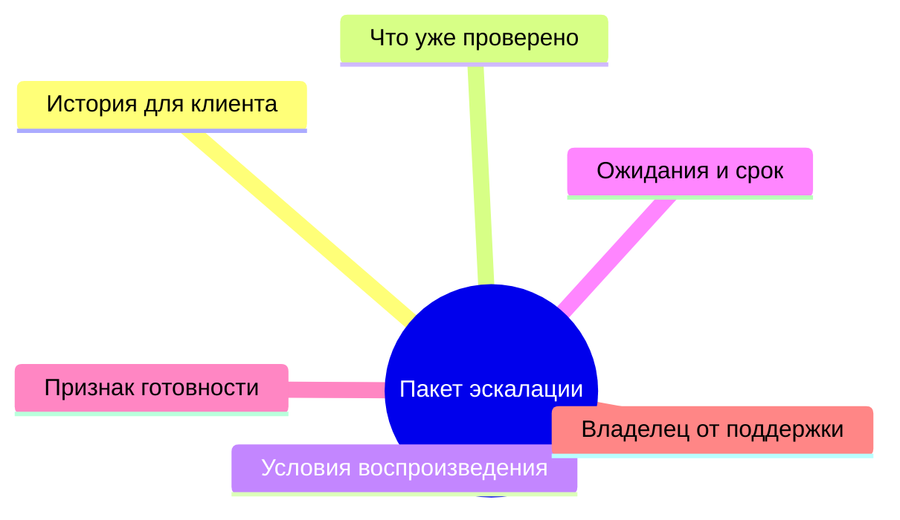
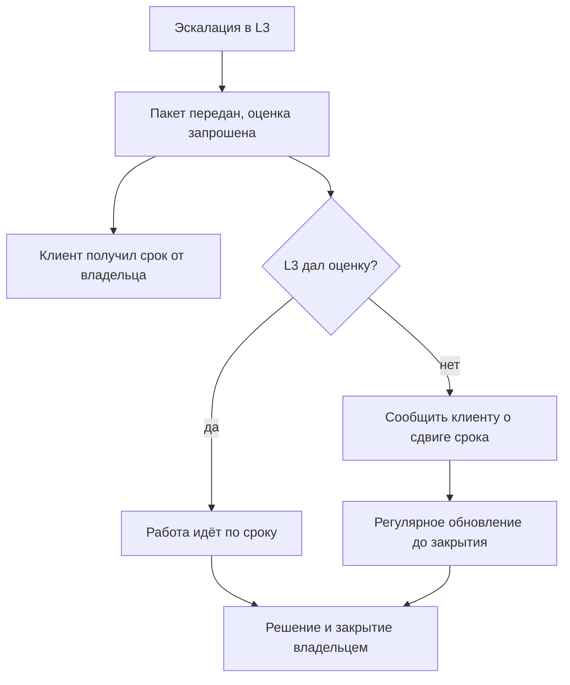

## Введение

Первые эскалации я делал с облегчением. Тикет уходил в третью линию, и вместе с ним уходило напряжение: теперь это не моя проблема. Через день выяснялось, что проблема всё ещё моя — клиент писал мне, разработчик спрашивал уточнения, а тикет возвращался с вопросом «а что вы уже проверили?». Работы стало больше, чем до эскалации.

Причина не в разработке, которая медленно отвечает, и не в клиенте, который торопит. Причина в том, что я передал тикет без пакета и без договорённости, а ответственность за клиента считал переданной вместе с ним. Ни того, ни другого в реальности не произошло.

В предыдущей статье серии — «Ни одного тихого нарушения SLA: еженедельный контроль очереди» — речь шла о контроле сроков и предупреждении нарушений. Эскалация — следующий шаг того же контура: что делать, когда срок под угрозой именно из-за зависимости от другой команды.

Тезис такой: эскалация — это передача работы с пакетом и договором о времени, но не передача ответственности за клиента. Разделение этих двух вещей и делает линию поддержки управляемой.

## Пакет эскалации

Пакет — это набор сведений, без которых третья линия не может начать. Его смысл не в бюрократии, а в экономии одного круга переписки: без пакета разработчик возвращает тикет с уточняющими вопросами, и первые сутки уходят не на решение, а на сбор контекста, который был у поддержки с самого начала.

Что входит в пакет:

- **История.** Что происходит с точки зрения клиента: что он делал, что ожидал, что получил.
- **Что уже проверено.** Дословно: какие шаги, в каком окружении, с каким результатом. «Перезагрузили» и «перезагрузили сервис на тестовом стенде, ошибка воспроизвелась» — разные сведения.
- **Условия воспроизведения.** Версия, окружение, время, шаги. Если не воспроизводится — так и написать, это тоже информация.
- **Ожидания клиента.** Не только «чтобы работало»: срок, который ему обещан, и что он будет делать, если решения не будет.
- **Признак готовности.** Что должно произойти, чтобы тикет считался решённым с точки зрения поддержки.
- **Владелец со стороны поддержки.** Имя, а не «команда».

Так выглядит состав пакета, если смотреть на него как на перечень, а не как на текст письма:

Пакет пишется один раз и потом только дополняется — в этом его сила. Он же становится основой для ответа клиенту: почти весь текст уже есть внутри.

Чем пакет не является — тоже полезно проговорить. Это не пересылка письма клиента: пересланное сообщение содержит эмоции, но не содержит проверок. Это не ссылка на ветку в чате: чат не читается через неделю. И это не список гипотез — гипотезы прикладываются отдельно и помечаются как гипотезы, иначе третья линия начинает проверять чужие догадки вместо своей работы. Пакет отвечает на вопрос «что известно точно», и именно это делает его полезным для обеих сторон: разработка не тратит время на сбор контекста, а поддержка не отвечает дважды на одни и те же вопросы.

<!-- вилка: свой шаблон пакета эскалации — какие поля обязательны и где он живёт. -->

## OLA с разработкой

Пакет решает половину проблемы: третья линия получает всё нужное. Вторая половина — время. Здесь начинается то, что в ITIL 4 называется OLA (Operational Level Agreement — внутреннее соглашение об уровне обслуживания между командами, в отличие от SLA с клиентом).

OLA отличается от SLA только стороной: обещание даётся не клиенту, а соседней команде. Механика та же: что именно обещаем, в каких единицах измеряется, что происходит при нарушении.

У OLA с разработкой обычно три предмета:

1. **Время первого ответа.** Не решения — ответа: «принял, смотрю» уже снимает неопределённость и позволяет сказать клиенту что-то определённое.
2. **Время до оценки.** Когда третья линия скажет, решается проблема в этом релизе или нет. Оценка — самый важный элемент: без неё нельзя назвать клиенту новый срок.
3. **Что при отказе.** Если L3 не берёт задачу — кто и в какой срок об этом сообщает, и куда задача идёт дальше.

Установить OLA проще всего не переговорами, а цифрой: прийти к разработке с фактическим временем первого ответа за последний месяц и спросить, какое значение они готовы держать. Договорённость, названная самим исполнителем, живёт дольше спущенной сверху.

Защищать OLA приходится двумя способами. Первый — измерять: то же время первого ответа по эскалациям, прозрачно для обеих сторон. Второй — регулярно смотреть на него вместе, а не вспоминать о договорённости в момент срыва. Систематическое нарушение OLA — не повод для скандала в конкретном тикете, а факт для разговора о ресурсе на уровне руководителей. Именно поэтому OLA иногда называют договором, который защищает не клиента, а команду поддержки.

<!-- вилка: фактическое время первого ответа L3 и что было сделано с нарушениями. -->

## Правило владельца клиента

Самое важное правило эскалации звучит коротко: ответственность за клиента не передаётся. Третья линия становится владельцем технической задачи — но не собеседником клиента и не тем, кто обещает сроки.

Из этого следует несколько практичных вещей.

- **Клиент всегда знает, кто говорит с ним.** Не «разработка», а конкретный человек из поддержки, который ведёт диалог.
- **Статус идёт с той же частотой, что и до эскалации.** Во время ожидания третьей линии клиент не должен проваливаться в вакуум: тишина после слова «эскалировали» читается как «забыли».
- **Срок обещает тот, кто может его пересогласовать.** Если срок называет лид поддержки по оценке разработки — то при изменении оценки первым узнаёт клиент, а не наоборот.
- **Возврат тикета не возвращает ничего автоматически.** Если задача вернулась без решения, поддержка не начинает с чистого листа: работа, уже проделанная третьей линией, остаётся частью истории.

Есть и обратная ошибка — гиперопека: поддержка пересказывает клиенту каждое движение разработчика, включая технические детали, которые клиенту не нужны. Правило владельца клиента — не про объём, а про ответственность: клиент получает не поток деталей, а понятный ответ, и получает его от одного человека.

Как это выглядит в работе:

## Чек-лист эскалации

Самая распространённая ошибка после эскалации — «передал в L3 и забыл». Антидот — короткий чек-лист, который проверяется на каждом тикете, который ушёл в другую команду.

1. **Пакет полный.** История, проверенное, условия, ожидания, признак готовности, владелец.
2. **OLA применён.** Время первого ответа и срок оценки названы, а не подразумеваются.
3. **Клиент знает срок и владельца.** Один человек ведёт диалог и обновляет статус.
4. **Есть контрольная точка.** Дата, к которой должен быть ответ от L3; если её нет в списке задач — её нет нигде.
5. **Тикет не остался без владельца.** У него два владельца: технический в L3 и клиентский в поддержке, и оба названы.
6. **Путь назад определён.** Чем закончится эскалация, если L3 откажет или не уложится: кому об этом сообщают и что дальше.

Чек-лист работает, пока у него есть внешний эффект: например, тикет без контрольной точки попадает в еженедельный разбор рисков. Без этого правила остаются намерением, а эскалации — поводом надеяться, что проблема решится сама.

<!-- вилка: сколько сейчас тикетов в эскалации и сколько из них без контрольной точки. -->

Самое ценное, что даёт такой порядок, — не скорость третьей линии, а возможность честно ответить клиенту в любой момент. Пока эскалация — это передача работы с пакетом и договорённостью, поддержка перестаёт быть промежуточным звеном и становится тем, кем должна быть: владельцем клиента.
