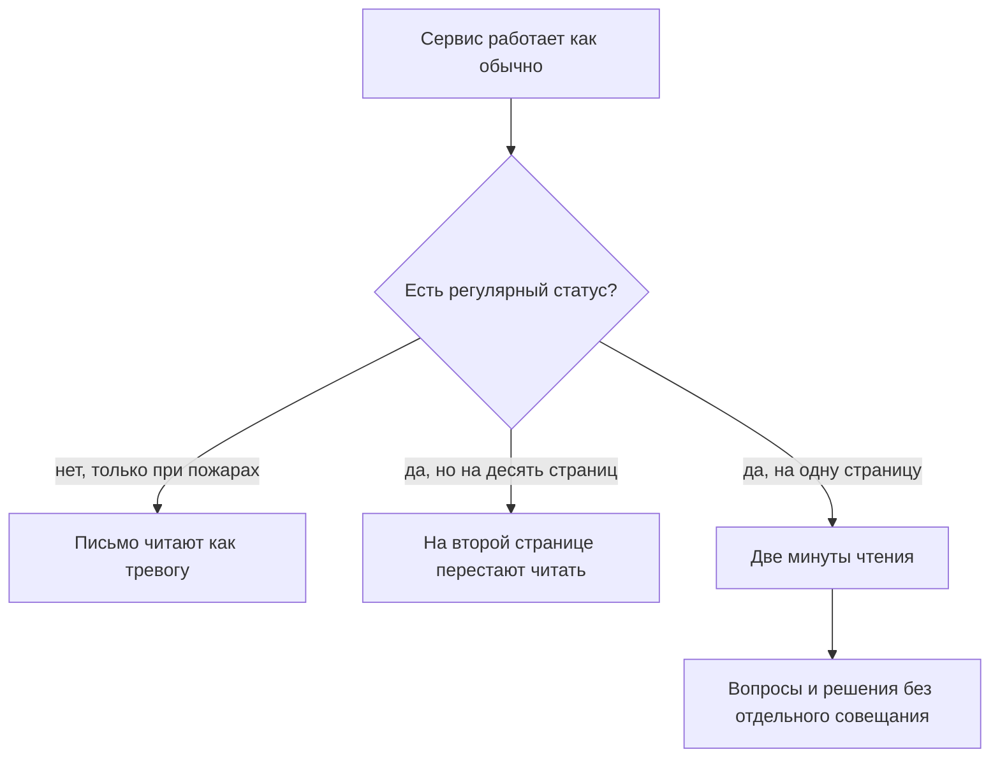

## Введение

Первый год я вёл статус поддержки так, как мне казалось правильным: раз в месяц собирал большую презентацию на тридцать слайдов, в которой было всё — метрики, графики, разборы, планы. Презентация была хорошая. Её никто не читал, включая меня самого через неделю после показа.

Однажды руководитель сказал фразу, которую я запомнил: «Я не могу читать отчёты длиннее страницы. Если тебе нужно больше — значит, ты не решил, что главное». Жестко и точно. Статус — это не доказательство проделанной работы, а инструмент решений, и у инструмента есть формат.

С тех пор контур прозрачности у меня состоит из двух вещей: еженедельное письмо на страницу и часовой обзор раз в месяц. Первое держит руководство в курсе и не требует его времени — читается за две минуты. Второе даёт место для разговора, который в письмо не влезает. Остальные отчёты и дашборды никуда не делись, но они перестали быть способом общения с руководством.

Этот текст — про механику: что в письме, из чего состоит час обзора и как статус меняет решения, а не только информирует.

## Тишина и отчёт на десять страниц

У коммуникации с руководством два вырожденных режима, и оба выглядят как работа.

**Тишина.** Пока всё в порядке, лид не пишет: зачем беспокоить, когда повода нет. Первое сообщение появляется, когда уже горит, и звучит как «у нас катастрофа». После двух-трёх таких писем включается режим по умолчанию: от лида ждут плохих новостей, любое его письмо читают с напряжением. Тишина кажется нейтральной, но она строит единственный сценарий — «лид пишет, когда плохо».

**Отчёт на десять страниц.** Другая крайность: лид пишет много, подробно и регулярно, выгружает всё, что есть в трекере, и добавляет разборы. Формально это полная прозрачность. Фактически руководитель перестаёт читать на второй странице — сначала по диагонали, потом никак. А если спросить его вне отчёта, он не сможет назвать ни одной цифры: объём вытеснил содержание.

Общее у этих режимов одно: ни один не приводит к решению. В первом случае решают без вас и без данных, во втором данные есть, но никто их не видел.

Есть и третий, самый коварный вариант: статус есть, он регулярный и даже короткий, но собирается из того, что легко посчитать. Тогда письмо много недель подряд выглядит благополучно, а очередь при этом растёт — потому что растут самые медленные заявки, а не самые заметные.

Полезно держать в голове простую мысль: статус нужен не для отчётности, а для того, чтобы руководство могло принять нужное решение в нужный момент — и чтобы это решение не требовало отдельного совещания. Дальше о том, как это выглядит на практике:

## Письмо на страницу: семь пунктов

Письмо пишется по одному и тому же шаблону каждую неделю. Постоянство важнее содержания одного письма: когда структура не меняется, руководитель за месяц запоминает, где искать ответ на свой вопрос, и перестаёт читать вступление.

Семь пунктов, каждый из которых отвечает на свой вопрос:

1. **Сводка.** Одна-две строки: это была обычная неделя или что-то вышло за рамки. Отвечает на вопрос «нужно ли вчитываться целиком».
2. **Объём.** Сколько пришло и по каким категориям. Отвечает на вопрос «что с потоком».
3. **Сроки.** Сколько заявок вне норматива, какие категории затронуты. Отвечает на вопрос «где болит сейчас».
4. **Инциденты.** Что случилось, чем закончилось, что изменим. Без имён виновных — только факты и решение.
5. **Очередь и висящие заявки.** Заявки, которые стареют и не закрываются своими силами. Отвечает на «что накопилось».
6. **Инициативы.** Где мы относительно заявленного плана: что сделано, что сдвинулось и почему.
7. **Просьбы.** Конкретно: какие решения или ресурсы нужны от руководства на этой неделе, с датой, к которой нужны.

Седьмой пункт — самый важный и самый часто пропускаемый. Письмо без просьб читается как сводка погоды: интересно, но делать ничего не нужно. Письмо с просьбами превращает его в рабочий инструмент.

Два правила, без которых шаблон не работает. Первое — формат страницы: не больше одной страницы, без вложений и без ссылок «см. дашборд», если в дашборде главное. Всё, что не влезло, идёт в месячный обзор, а не в следующее письмо. Второе — та же дата: письмо уходит в один и тот же день, чтобы не приходилось его ждать.

<!-- вилка: свой шаблон письма — точные формулировки семи пунктов, куда и когда отправляется, кто читатели. -->

## Часовой месячный обзор

Письмо хорошо для состояния, плохо для разговора. Раз в месяц нужен час, где собраны люди, принимающие решения, и есть возможность обсудить вещи, которые в две минуты чтения не влезают.

Повестка часа у меня всегда одна и та же:

- **Пять минут — картина по метрикам.** Не пересчёт цифр из писем, а динамика за месяц и один вывод из неё.
- **Пятнадцать минут — SLA-нарушения.** Не сводка, а два-три разбора: что именно произошло, какой системный элемент это породил, какое изменение последует.
- **Пятнадцать минут — инициативы.** Статус по каждой: сделано, в работе, встало. На «встало» — причина и решение, а не описание.
- **Пятнадцать минут — риски.** То, что ещё не случилось, но случится, если не менять ничего: ёмкость, ключевые люди, зависимости от третьих команд.
- **Десять минут — решения и поручения.** Фиксируются владельцы и сроки, всё остальное записывается в протокол.

Два условия, без которых час превращается в ещё один отчёт. Первое: на обзоре присутствуют те, кто может решать, а не только те, кто хочет слушать. Второе: у каждого пункта есть вывод — либо решение, либо сознательное «решили не делать», зафиксированное в протоколе. Обзор без решений хуже, чем его отсутствие: он занимает час и создаёт ощущение, что всё под контролем.

<!-- вилка: своя повестка обзора — кто участвует, где ведётся протокол, что изменилось после первых обзоров. -->

## Как статус меняет решения

Самая частая ошибка в статусах — считать, что цель — информировать. Информирование — побочный эффект. Цель — чтобы руководство смотрело на сервис теми же глазами, что и вы, и решало на тех же данных.

Это видно по тому, меняются ли решения. Если за квартал ни одно решение руководства не опиралось на ваши письма и обзоры, значит статус существует отдельно от управления: его читают, кивают и живут дальше.

Что делает статус работающим:

- **Цифры с действиями.** У каждой метрики в обзоре есть следствие: если значение такое, делаем это. Метрика без следствия превращает обзор в чтение графиков.
- **Плохие новости первыми.** В письме, где всё хорошо, плохая строка в конце читается как случайность. Плохая новость в первом абзаце даёт руководителю время на реакцию — и доверие к остальному тексту.
- **Одна тема требует решения.** В каждом письме и в каждом обзоре есть ровно одна вещь, где нужен ответ руководства. Если просьб десять, не будет выполнена ни одна.
- **История.** Письма складываются в хронологию: видно, когда появилась проблема и что делалось. Через полгода это единственный способ не начинать разговор с начала.

И техническая деталь, которая экономит час: обзор готовится заранее и рассылается до встречи. Если участники видят цифры впервые на самой встрече, первые двадцать минут уходят на их чтение, а не на разговор. Письмо и обзор — не два независимых ритуала, а один контур: недельные письма собираются в месячную картину, а решения из обзора возвращаются в следующие письма как выполненные или сдвинувшиеся пункты.

<!-- вилка: пример, когда статус изменил решение руководства — что было в письме, какое решение принято, к какому сроку. -->

Статус — не бюрократия и не доказательство занятости. Это способ сделать так, чтобы руководство узнавало о проблеме раньше, чем она станет инцидентом, и чтобы решения принимались в момент, когда их ещё дёшево принимать. Следующая статья серии — о том, как просить эти решения: эскалация и запрос ресурсов по схеме, а не по эмоциям.
