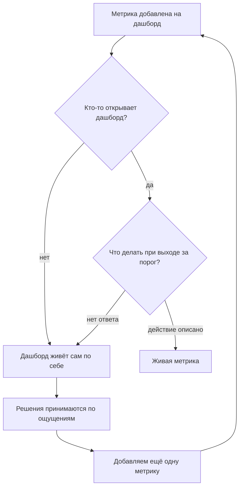
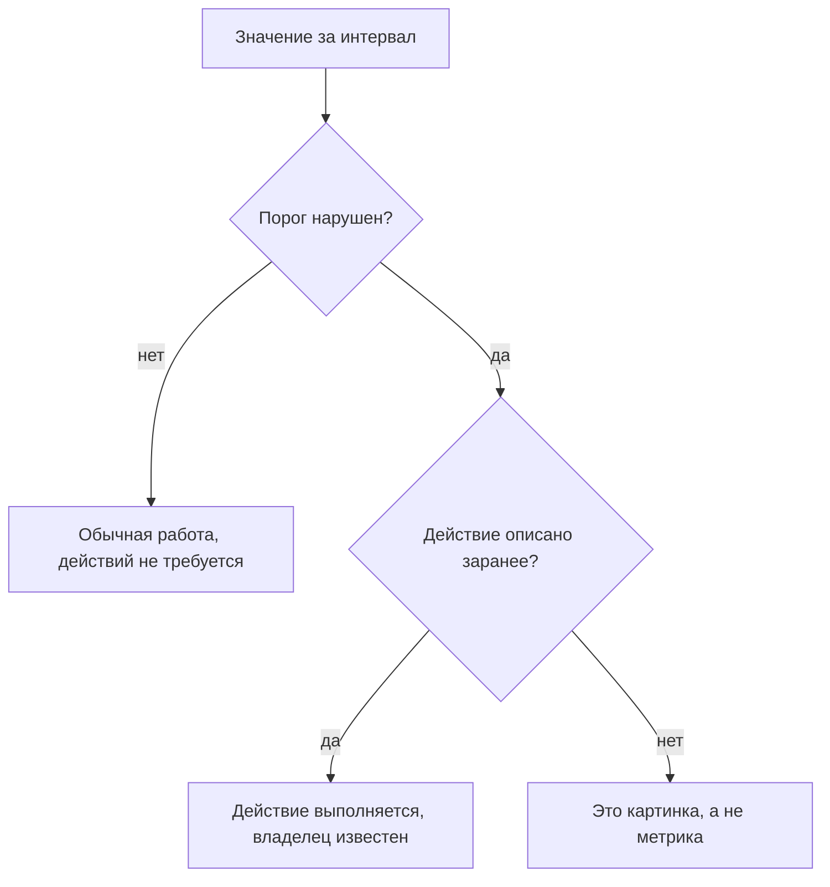
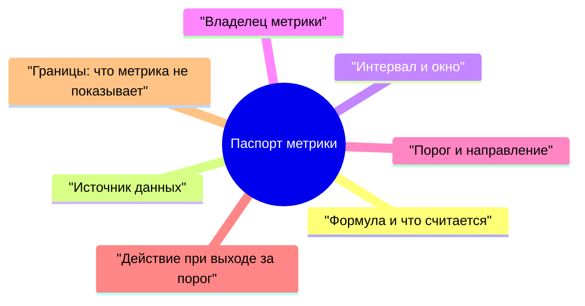

## Введение

Дашборд есть у каждой поддержки, и почти у каждой он не меняет ни одного решения. Цифры обновляются, графики живут своей жизнью, а разговор на планёрке всё равно идёт в терминах «вроде справляемся» и «вроде стало хуже». Метрика присутствует, решения — нет.

Я пришёл к простому критерию, который отсекает большинство бесполезных измерений: у метрики должно быть действие, которое наступает после выхода за порог. Если ответ на вопрос «что мы делаем, если значение ушло за границу» отсутствует, то это не метрика, а иллюстрация: она описывает прошлое и не влияет на будущее.

В этой статье — почему дашборды умирают, как выглядит критерий живой метрики, что записывается в паспорт и с каких трёх метрик стоит начинать, чтобы не утонуть. Она продолжает линию, начатую в «Baseline раньше целей»: там речь шла о том, откуда берутся числа и как они превращаются в цели; здесь — о том, как числа превращаются в действия.

## Музей метрик

Первый дашборд, который я получил в наследство, был красивым и бесполезным. Метрики в нём появлялись по одной: кому-то из руководства было интересно, сколько заявок приходит ночью, кому-то — какая доля клиентов пишет повторно. Каждое пожелание выполнялось, и через год на экране было столько графиков, что читать их стало невозможно.

Музей метрик узнаётся по признакам, которые не связаны с качеством самих цифр:

- **Дашборд никто не открывает.** Кроме случаев, когда нужно сделать скриншот для отчёта.
- **Значение не обсуждается.** На вопрос «почему упало» отвечают «сезонность», и на этом разговор заканчивается.
- **Ни одно решение не изменилось.** Ни приоритет очереди, ни штат, ни регламент — ничего не зависело от этих чисел.
- **Коллекция растёт.** Каждый квартал появляется новая метрика, а старая остаётся: убрать страшнее, чем добавить.

Механика вырождения простая: метрика добавляется, чтобы ответить на чей-то вопрос, но никто не договаривается, что делать с ответом. Через несколько циклов дашборд перестаёт быть инструментом и становится архивом.

Отдельная ловушка — удаление. Убрать метрику психологически труднее, чем добавить: кажется, что без неё мы ослепнем. На деле ослепляет как раз избыток графиков: когда их десяток, не смотрит никто.

Выход из круга один — не чистить дашборд, а договориться о действиях. Дальше — как выглядит эта договорённость.

## Критерий живой метрики

Один вопрос отделяет инструмент от картинки: что происходит в понедельник, если цифра за неделю вышла за порог? Ответ должен быть конкретным: кто-то что-то делает до такой-то даты. Если ответа нет, метрика не работает — сколько бы труда ни ушло на её сбор.

Из этого критерия вытекают три следствия, которые я проверяю у любой новой метрики.

**У метрики есть владелец.** Не «команда следит», а человек, который смотрит значение и запускает действие. Без владельца метрика живёт до первого отпуска.

**У метрики есть порог, а не только график.** Порог — это граница, за которой команда договорилась действовать. Он может быть грубым: важно не точное число, а то, что пересечение границы означает конкретный разговор, а не новую дискуссию о том, хорошая ли цифра.

**У метрики есть границы интерпретации.** Любая метрика что-то не показывает, и это записывается отдельно. Иначе через месяц её начнут использовать для выводов, которые она не поддерживает, — и доверие к ней умрёт вместе с первым таким выводом.

Как это выглядит в применении:

Есть и обратная проверка, которая нравится мне больше всего: метрика должна быть кому-то неудобна. Если значение всегда в норме и никогда не требует разговора, она не проверяет ничего, кроме собственной исправности.

## Паспорт метрики по полям

Паспорт — это страница на каждую метрику, где записано всё, без чего её невозможно интерпретировать одинаково. Форма скучная, но именно она убирает главный источник споров: разные люди считают разные вещи под одним названием.

Поля по существу:

- **Формула.** Что в числителе, что в знаменателе, что исключено из расчёта. Скучные детали вроде «считать по событиям, а не по текущим статусам» или «не учитывать заявки, закрытые по просьбе клиента» решают больше, чем сама метрика.
- **Источник данных.** Конкретная система и правило выгрузки. Один период — один источник: данные из трекера, чата и памяти не смешиваются.
- **Интервал и окно.** Как часто смотрим и за какой период считаем. Недельный контроль при квартальном окне — рабочая комбинация: она убирает шум отдельных недель.
- **Владелец.** Человек, который отвечает за значение и за действие. У него есть право прийти к лиду с проблемой по этой метрике.
- **Порог и направление.** Что считается нормой и какой дрейф является сигналом. Направление важнее абсолютного значения: медленный рост доли повторных обращений важнее, чем сама цифра сегодня.
- **Действие.** Что именно делается при выходе за порог: кто, что и в какой срок. Если действие невозможно сформулировать, метрика лишняя, и это повод её не заводить.
- **Границы.** Что метрика не показывает и для каких выводов не годится.

Полезное правило заполнения: паспорт пишет тот, кто будет действовать по метрике, а не тот, кто её собирает. Аналитик может посчитать что угодно, но если у значения нет потребителя, паспорт превращается в документ ради документа.

И ещё одно — про пересмотр. Паспорт не высечен в камне: формулы и пороги уточняются по мере накопления данных, но каждое изменение фиксируется с датой и причиной. Без этого через год невозможно сравнить значения: цифра та же, а считается уже иначе, и все выводы о движении становятся спорными.

<!-- вилка: пример одного своего паспорта целиком — формула, источник, окно, владелец, порог, действие. -->

## Набор метрик серии

Одна метрика отвечает на свой вопрос; только набор закрывает то, ради чего существует поддержка: быстро ли мы отвечаем, качественно ли решаем, растёт ли знание, не выгорает ли команда.

| Метрика | Что показывает | Что не показывает |
| --- | --- | --- |
| Время первого ответа (FRT) | Как быстро клиент получает содержательный ответ | Не отличает живой ответ от шаблонного, если определение не зафиксировано |
| MTTA — среднее время до подтверждения заявки | Скорость реакции дежурной смены | Скрывает распределение: среднее может быть в норме при провалах в отдельных сменах |
| MTTR по исходам — среднее время решения | Сколько проблема живёт у клиента | Смешивает работу команды с ожиданием клиента, если не разделять эти времена |
| FCR — доля решений при первом обращении | Как часто хватает одного касания | Растёт при агрессивном закрытии и падает при честной классификации |
| CSAT с охватом | Как клиент оценивает решение | Без охвата не интерпретируется: отвечают в основном крайние случаи |
| Доля повторных обращений | Качество решения, а не скорость закрытия | Зависит от того, считается ли обращение по той же теме повтором |
| Доля решений по базе знаний | Зрелость знаний и потенциал самообслуживания | Не показывает, была ли статья полезной: инженер мог сослаться и всё равно объяснить |
| eNPS команды | Насколько люди готовы рекомендовать работу здесь | Про людей, не про клиентов; измеряется редко и не годится для недельного контроля |

Несколько правил про набор целиком, без которых таблица превращается в тот самый музей.

**Метрик должно быть меньше, чем действий.** Если на дашборде десять чисел, из них живых обычно два-три. Остальные стоит убрать — не потому, что они плохие, а потому, что внимание команды ограничено.

**MTTA и MTTR считаются раздельно по критичности и по исходам.** Общая средняя по всем заявкам смешивает минуты и недели и не говорит ничего.

**CSAT не читается без охвата.** Удовлетворённость без доли ответивших — это оценка тех, у кого было настроение отвечать.

**Доля решений по базе знаний без контекста вводит в заблуждение.** Она растёт, когда статьи есть, и падает, когда классификация становится честнее.

**eNPS измеряется редко и не превращается в недельный контроль.** Его задача — увидеть динамику за квартал, а не ловить колебания.

<!-- вилка: какие метрики у вас на дашборде сейчас, какие из них действительно живые и какие данные есть в трекере. -->

## Старт с трёх метрик

Соблазн при перестройке дашборда — собрать сразу всё. Этот путь ведёт в тот же музей, только быстрее: десять паспортов за месяц не заполняет никто, даже сам автор идеи. Медленный старт выглядит менее убедительно в презентации, зато через квартал три живые метрики делают для управления больше, чем весь прошлый дашборд.

Рабочий старт — три метрики, по одной на каждый вопрос:

1. **Скорость.** Время первого ответа или MTTA — то, что команда может изменить своими действиями уже на этой неделе.
2. **Качество.** Доля повторных обращений или FCR — то, что не даёт гнать скорость за счёт клиента.
3. **Знание или люди.** Доля решений по базе знаний либо eNPS — то, что показывает, растёт ли система, а не только её пропускная способность.

Порядок внедрения, который я считаю рабочим:

- выбрать три метрики и написать три паспорта: коротко, на страницу каждую;
- измерить точку А по тем же правилам, по которым считаем дальше;
- договориться о порогах с командой, а не спустить их сверху: порог, в который никто не верит, не запускает действий;
- проверить через месяц главное: было ли хотя бы одно решение, принятое по этим числам? Если нет, метрика мёртвая — либо у неё не тот порог, либо не тот владелец;
- добавлять четвертую метрику только после того, как три проживут квартал.

<!-- вилка: свои паспорта трёх–пяти метрик и текущие значения — что стало действием в первый квартал. -->

Живая метрика меняет не отчёт, а поведение: кто-то открывает значение, видит выход за порог и делает то, что записано в паспорте. Всё остальное — графика, которая делает отчёт похожим на управление.

Следующая статья серии — «Аудит живучести: что сломается, когда вас не будет» — о том, какие из этих механизмов переживут ваш отпуск, а какие держатся только на привычке.
