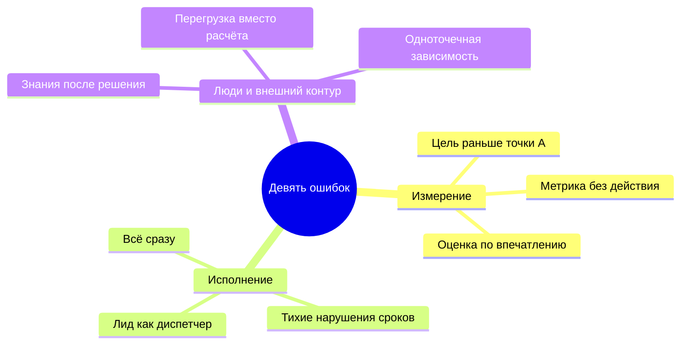
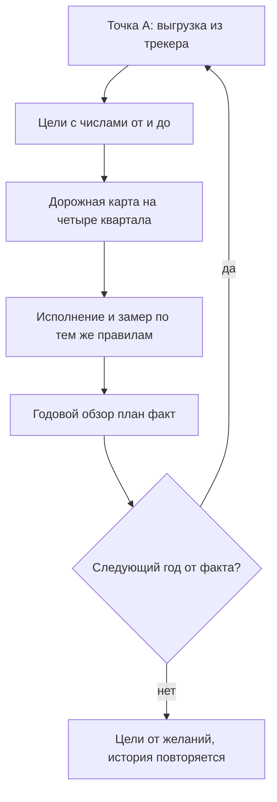
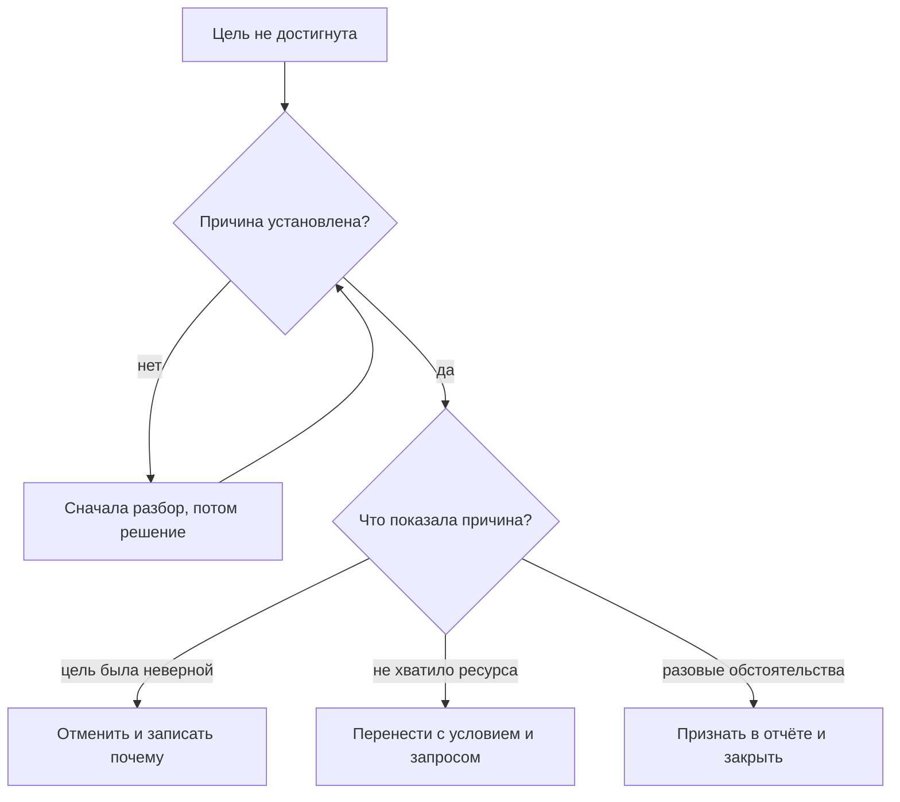

## Введение

Год у лида поддержки заканчивается дважды. Сначала закрывается последний квартал, потом — отчёт. И если с кварталом всё более или менее понятно, то отчёт — единственный момент в году, когда приходится честно ответить на вопрос, который весь год откладывался: что из обещанного действительно произошло.

За несколько лет и на нескольких сервисах я собрал свой список ошибок, которые совершал сам, — часть повторно. В годовом плане, по которому я работаю, он сведён к девяти формулировкам, и у каждой есть антидот: конкретный артефакт или правило, которое эту ошибку закрывает. Логика у всех девяти общая: в моменте ошибка выглядит как разумное действие — поставить цель, взять всё на себя, запустить побольше сразу, — а платить за неё приходится кварталом.

Эта статья закрывает серию, поэтому у неё две задачи. Первая — показать девять ошибок так, чтобы любую из них можно было узнать в собственной неделе. Вторая — довести год до отчёта: разобрать, как выглядит сверка «план/факт», как из неё получается план следующего года и что делать с тем, что не сбылось.

## Девять ошибок и антидоты

Важная оговорка: это не список чужих грехов. Я совершал каждую из этих ошибок и возвращаюсь к некоторым до сих пор — обычно после того, как сервис меняет масштаб или состав. Формат трёх колонок простой: как ошибка формулируется, как она выглядит на практике и чем лечится.

| Ошибка | Как выглядит на практике | Антидот |
| --- | --- | --- |
| Цель раньше измерения | Годовой план начинается с «поднять удовлетворённость», а точки А нет | Сначала выгрузка из трекера, потом цель с числами «от», «до», сроком и владельцем |
| Лид как единственный диспетчер | Каждый нестандартный тикет доходит до лида, его отпуск останавливает маршрутизацию | Три списка границ, триаж при первом касании, матрица маршрутов вместо личной функции |
| Всё сразу | Десяток инициатив в одном квартале, ни одна не закрыта | Правило последовательности: следующий квартал — только после результата предыдущего |
| Метрика без действия | Дашборд, который никто не открывает, и цифры, из которых ничего не следует | Паспорт метрики: формула, источник, порог и действие; нет действия — нет метрики |
| Тихие нарушения сроков | Просроченные заявки всплывают на разборе через месяц | Еженедельный контроль очереди и сигнал по таймеру, а не по памяти |
| Знания после решения | Статья в базу пишется «когда будет время» и не пишется никогда | KCS: статья создаётся в момент решения, у базы есть владелец и шаблон |
| Оценка по впечатлению | В 1:1 звучит «старается» и «молодец», критериев нет ни у кого | QA-выборка и критерии качества, наблюдаемые факты вместо ощущений |
| Перегрузка вместо расчёта | На каждой планёрке «мы перегружены», и ни одной формулы | Расчёт мощности и запрос ресурса по данным, с альтернативами |
| Одноточечная зависимость | Отпуск одного человека — инцидент, уход — катастрофа | Норматив подхвата, второй носитель каждого навыка, аудит живучести |

<!-- вилка: сверьте формулировки с §9 годового плана и добавьте 1–2 ошибки, которые встречались именно у вас. -->

Если присмотреться, девять ошибок делятся на три семейства, и каждое закрывается своим типом работы.

Измерение — про то, что мы не знаем, откуда считаем. Исполнение — про то, что мы берёмся за много и держим маршруты в своей голове. Люди и внешний контур — про то, что сервис держится на героизме и на отсутствии разговора с теми, кто вне поддержки. Внутри каждого семейства антидоты взаимозаменяемы по смыслу: выгрузка превращается в паспорт метрики, паспорт — в расчёт мощности, расчёт — в запрос ресурса.

И ещё одна общая черта: антидот не действие, а привычка. Выгрузка из трекера сделана один раз — это не точка А, а любопытство. Списки границ составлены один раз — это не границы, а документ, который устарел через месяц. Ошибки возвращаются каждый раз, когда сервис меняет масштаб, а привычка — то, что удерживает их за дверью.

<!-- вилка: какие из девяти ошибок вы совершали и что помогло конкретно вам. -->

## Годовой обзор план/факт

Годовой отчёт я понимаю не как презентацию достижений, а как сверку. В нём по каждому результату года видны четыре вещи: что планировали, что показал факт, чем объясняется расхождение и что из этого следует для следующего года. Если четвёртого пункта нет, отчёт превращается в исторический документ.

Структура отчёта повторяет структуру года: сначала базовая рамка (результаты, границы, baseline, дорожная карта), потом стабилизация, знания, люди, внешний контур, метрики. По каждой теме — короткий блок, а не рассказ о процессе. Правила, без которых сверка перестаёт быть сверкой:

- **Одни и те же определения.** Цифра в отчёте считается по тому же определению, что и в точке А. Если определение поменялось по ходу года, это фиксируется отдельной строкой, а не замалчивается.
- **Числа из трекера, а не из памяти.** Отчёт, собранный по воспоминаниям о тяжёлых месяцах, всегда рассказывает более драматичную историю, чем было.
- **Расхождение объясняется системой, а не людьми.** «Не хватило мощности», «цель была поставлена до измерения», «инициатива не имела критерия готовности» — это объяснения, с которыми можно работать. «Команда не вытянула» — нет.
- **Несбывшееся в отчёте есть.** Отчёт без провалов читается как отчёт, в котором их спрятали, и обесценивает всё остальное.
- **У каждого вывода есть адресат.** Изменение попадает в план, в регламент, в запрос ресурса или в отказ от цели — иначе оно остаётся настроением.

<!-- вилка: ваши результаты года — 3–5 показателей с планом и фактом и объяснением расхождения. -->

Отчёт, который собирается за один вечер в конце декабря, почти всегда получается или хвалебным, или паническим — зависит от того, каким был последний месяц. Поэтому я собираю его по кускам в течение года: каждый квартальный обзор добавляет свой блок, и в декабре остаётся только свести их и написать выводы. Побочная выгода важнее: квартальная сверка показывает расхождение тогда, когда ещё можно что-то изменить, а не тогда, когда уже поздно.

## План следующего года от факта

Главное правило перехода от отчёта к плану: следующий год начинается не с желаний, а с нового факта. Факт конца декабря — это точка А для января, и всё, что в прошлом году было целью, в этом становится отправной точкой. Именно поэтому серия и начинается с baseline: без измеренной точки отсчёта каждый следующий год стартует с нуля и с теми же обещаниями.

Цикл выглядит так:

Практически это выглядит скромнее, чем звучит. В план следующего года входит не больше четырёх-пяти результатов, у каждого есть владелец, срок и способ проверки. Всё, что не попало, живёт в списке «не сейчас» — и это нормально: план из четырёх пунктов, доведённых до конца, меняет сервис сильнее, чем план из девятнадцати, из которых не закрылся ни один.

<!-- вилка: что вошло в ваш план следующего года и от какого факта вы отсчитывались. -->

## Что делать с несбывшимся

Самый тяжёлый раздел отчёта — тот, где перечислено, что не сделано. Соблазн понятен: переформулировать так, чтобы выглядело выполненным, перенести в следующий год без объяснений или просто убрать. Все три способа гарантируют, что через год список будет длиннее.

С несбывшимся есть три честных исхода, и у каждого должен быть владелец решения.

Правила здесь такие:

1. **Различать «не сделали» и «не сработало».** Не сделали — не было времени, ресурса, приоритета. Не сработало — сделали, а метрика не двинулась. Лечение у этих случаев разное, и путать их нельзя.
2. **Не переписывать историю.** Формулировка цели в отчёте — та же, что была в плане, даже если сегодня она кажется наивной. Иначе через год не с чем сравнивать.
3. **У каждого несбывшегося пункта есть решение, а не статус.** «В работе» — это не решение. Отменить, перенести с условием, признать неверной — это решения.
4. **Перенос без условия — это отмена.** Если пункт переехал в следующий год, у него есть новый срок и новое условие; без них он переехал не в план, а в привычку.

И последнее правило этого раздела: разбор несбывшегося ведётся без имён. Как только в объяснении появляется конкретный человек, обсуждение перестаёт быть про систему: остальные начинают защищаться, а причины, которые действительно важно было найти, исчезают из разговора. «Не хватило мощности», «не было критерия готовности», «маршрут держался на одном человеке» — это формулировки, с которыми можно работать дальше. Имена в такой разбор не входят ни в каком виде — включая своё.

<!-- вилка: 2–3 пункта своего года, которые не сбылись, — что именно решили с каждым. -->

## Финал серии

Серия «Стратегия управления поддержкой» писалась как система, а не как набор советов: каждая статья опирается на предыдущую, и проверяется она не сама по себе, а вместе с соседними. Вот она целиком, в порядке выхода.

**Стратегическая рамка года**

- [Пять результатов работы лида поддержки](/ru/blog/support-lead-five-results/) — 2026-03-31
- [Границы ответственности](/ru/blog/support-lead-boundaries/) — 2026-06-07
- Baseline раньше целей — 2026-11-10
- Год лида по кварталам — 2026-11-13

**Стабилизация сервиса**

- Карта сервиса и Точка А — 2026-11-15
- Триаж при первом касании — 2026-11-18
- Ни одного тихого нарушения SLA — 2026-11-21
- Эскалация в L3 — 2026-11-24

**Знания как система**

- KCS в рабочем потоке — 2026-11-26
- Шаблон статьи базы знаний и владелец КБ — 2026-11-29
- Повторяющиеся проблемы — 2026-12-02
- Самообслуживание как Shift Left — 2026-12-05

**Команда: люди и развитие**

- Ритм руководителя: правило 40 % — 2026-12-07
- 1:1, которые не превращаются в отчёт — 2026-12-10
- Оценка по наблюдаемым фактам — 2026-12-13
- Матрица компетенций — 2026-12-15
- Мощность вместо героизма — 2026-12-18

**Внешний контур**

- Матрица взаимодействий — 2026-12-21
- Статус руководству — 2026-12-24
- Просить решения, а не сочувствия — 2026-12-26
- Blameless-разбор инцидента — 2026-12-29
- Карточка проблемы для продукта — 2026-12-31

**Метрики и замыкание года**

- Метрика без действия — 2027-01-04
- Аудит живучести — 2027-01-06
- Девять ошибок лида поддержки — эта статья

Спасибо, что дочитали до конца: год лида складывается не из методов, а из привычек, и девять ошибок — это не приговор, а список того, что стоит перенести в план. Если у вас есть своя ошибка, которой нет в таблице, — напишите, я буду рад дополнить список и обсудить его в следующей серии.
