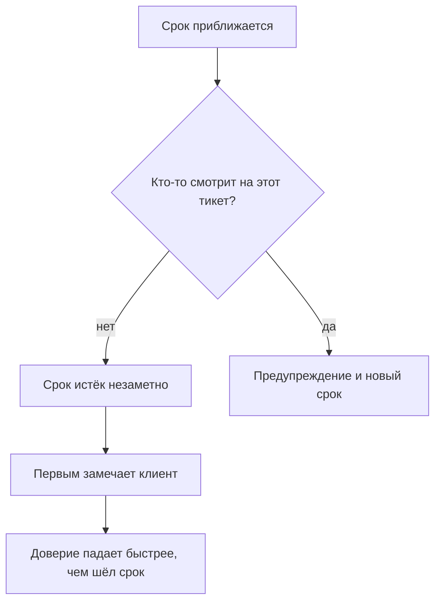

## Введение

О первом нарушении SLA (Service Level Agreement — соглашение об уровне сервиса с клиентом) я узнал из письма клиента. Не из отчёта, не из трекера, не от инженера — из письма, в котором было написано «вы обещали ответить вчера». Заявка при этом была в работе, инженер был занят другим, срок истёк спокойно и незаметно.

Именно это слово — незаметно — и есть проблема. Нарушение срока само по себе неприятно, но объяснимо: случилось, разобрали, поправили. Нарушение, о котором первым узнал клиент, ломает другое: веру в то, что сервис видит свою работу. После такого письма клиент начинает проверять сам, а каждый его вопрос звучит как недоверие.

В предыдущей статье серии — «Триаж при первом касании: категория, критичность, маршрут» — речь шла о том, чтобы каждое обращение на входе получало критичность, категорию и владельца. Эта статья о следующем контуре: о регулярном контроле, который замечает риск до того, как он станет фактом.

Тезис такой: нарушение срока — управляемое событие, если оно видно заранее. Тихое нарушение — это не сбой команды, а сбой контроля: никто не смотрит на очередь в те моменты, когда ещё можно что-то сделать.

## Почему нарушения находят клиенты

У тихого нарушения всегда один и тот же сценарий.

Почему так происходит почти всегда:

- **Трекер показывает статусы, а не риски.** Заявка «в работе» выглядит одинаково и за час до срока, и через неделю после него.
- **Смотрят на отчёт, а не на очередь.** Отчёт за прошлый месяц отвечает на вопрос, что уже случилось. Для предотвращения нужен список того, что случится на этой неделе.
- **Каждый думает, что смотрит кто-то другой.** Инженер считает, что сроки контролирует лид, лид — что ответственный инженер, а отчёт формируется автоматически и его никто не читает.
- **Срочное вытесняет важное.** Пока в очереди горит один инцидент, все остальные сроки продолжают идти — но внимания на них уже нет.

<!-- вилка: собственный случай тихого нарушения — как обнаружилось и чем закончилось. -->

У этого сценария есть неприятное свойство: он воспроизводится тем чаще, чем лучше команда справляется с текущим потоком. Чем меньше пожаров, тем меньше поводов смотреть в очередь целиком.

## Три фильтра рисков

Контроль, который работает, прост до скуки: раз в неделю выгрузка из трекера прогоняется через три фильтра, и каждый попавший туда тикет получает действие.

**Первый фильтр — срок истекает скоро.** Не «нарушен», а «будет нарушен, если ничего не изменить». Сюда попадают заявки, у которых до норматива осталась примерно четверть времени или меньше. Это самый важный фильтр: только здесь ещё можно успеть без последствий.

**Второй фильтр — нет ответа несколько дней.** Заявка открыта, но с ней ничего не происходит: ни ответа клиенту, ни движения внутри. Порог зависит от нормативов, но сам факт тишины важнее точной цифры: тишина в тикете всегда означает, что владелец потерял его из виду.

**Третий фильтр — реопен.** Заявка была закрыта и открыта снова. Это не новый тикет, а сообщение о том, что предыдущее решение не сработало — и по этому обращению счётчик времени обычно уже обнулён, хотя обещание клиенту — нет.

| Фильтр | Что ищем | Действие |
| --- | --- | --- |
| Срок истекает | До норматива меньше четверти времени | Связаться с владельцем и выбрать: успеть или пересогласовать срок |
| Нет ответа | Тишина в тикете несколько дней | Вернуть владельцу и назначить срок следующего шага |
| Реопен | Заявка открыта повторно | Разобрать причину возврата, а не только симптом |

Главное правило: **на каждый тикет из фильтра — действие, а не отметка «посмотрели»**. Действий всего три: успеть, пересогласовать, эскалировать. Четвёртого — «подождать ещё» — не существует, потому что это и есть механизм, которым рождаются тихие нарушения.

<!-- вилка: свои пороги фильтров и ритм прогона — когда и кем смотрится очередь. -->

Прогон занимает не весь день, а полчаса, и его ценность не в списке, а в привычке: очередь просматривается целиком, а не по кускам. Если раз в неделю этого не происходит, риск становится фактом без всякого злого умысла.

## Предупреждение до нарушения

Если фильтр сработал и понятно, что срок не выдержать, следующий шаг — сообщить об этом первым. Это неприятно и кажется признанием провала, хотя на самом деле всё наоборот: предупреждение — это выполнение обещания сообщать о проблемах раньше, чем их заметит клиент.

Сообщение клиенту строится из четырёх частей, и каждая обязательна:

1. **Что происходит.** Без обтекаемых формулировок: заявка в работе, срок сдвигается.
2. **Почему.** Одна-две фразы по существу. Не «сложная ситуация», а «нужно воспроизвести проблему на тестовом окружении».
3. **Новый срок.** Конкретный и реальный, а не «скоро». Срок, который не выдержан, — второе нарушение, хуже первого.
4. **Что делает клиент.** Обычно — ничего: он получает обновление к названному времени. Если от него что-то нужно, это говорится прямо.

Внутреннее сообщение отличается одним: в нём есть действие. Не «информирую о риске», а «предлагаю такой вариант: ускоряем внутри или переносим срок с согласия клиента; если второе, нужен ваш ответ до такого-то времени». Такое сообщение не требует от руководителя сочувствия, оно требует решения.

<!-- вилка: пример письма клиенту и короткого внутреннего сообщения о риске. -->

## Сигнал системной проблемы

Отдельный тикет в фильтре — рабочая ситуация. Два похожих риска в одной категории за неделю — уже гипотеза о системе, и её стоит проверять, пока она не превратилась в закономерность.

Различить случайность и систему помогают три вопроса.

- **Где именно повторяется?** Одна категория, один продукт, одна линия, один клиент. Если риск второй раз приходит из одного места, дело не в людях, а в правилах этого места.
- **Чем похожи сроки?** Например, риски появляются на этапе ожидания третьей линии. Значит, договорённость с ней не выдерживается — и никакая дисциплина внутри поддержки этого не исправит.
- **Что уже пытались сделать?** Если после первого случая ничего не изменилось, второй — не новость, а подтверждение.

Ответы обычно указывают на одну из двух причин: триаж поставил неверную критичность, и тикет попал не в ту очередь, или мощности не хватает на текущий поток. Первое лечится правилами, второе — только разговором о ресурсе. Смешивать эти два разговора нельзя: пока причина не названа, любое решение выглядит как «поработать интенсивнее».

Дальше сигнал живёт уже не в отчёте, а в повестке. Если причина — неверная критичность, правится матрица и обучение триажа. Если мощность — нужны цифры: сколько часов работы в неделю требует поток и сколько есть. Это уже не про контроль очереди, а про расчёт потребности, и эта тема — из другого раздела серии.

## Урок из нарушения

Нарушения будут. Даже с тремя фильтрами, согласованными сроками и предупреждениями остаются случаи, где всё пошло не так. Вопрос не в том, как их исключить, а в том, что остаётся после.

Я фиксирую в разборе четыре вещи, и ни одна из них не про имена:

- **Хронология.** Когда обращение пришло, когда получило критичность, когда попало к владельцу, когда срок стал под угрозой и когда истёк. Только время и события.
- **Что не сработало.** Фильтр не увидел, владелец не отреагировал, договорённость с другой командой не выдержалась. Формулировка без глаголов «забыл» и «прошляпил»: система, в которой можно забыть, — дефект системы.
- **Что было сделано после.** Предупреждение клиенту, перенос срока, компенсация — всё, что произошло по факту.
- **Одно изменение.** Не список из десяти пунктов, а одно правило, которое меняет процесс так, чтобы этот случай стал невозможен или заметен раньше.

Итог разбора — не наказание и не протокол для отчёта, а изменение в системе. Если после нарушения ничего не изменилось, кроме настроения участников, следующее нарушение — вопрос времени.

<!-- вилка: свой разбор нарушения — что было изменено в процессе после него. -->

Смысл всего этого контроля — не ноль нарушений. Ноль нарушений бывает только там, где нечего обещать. Смысл в том, чтобы ни одно нарушение не стало для клиента новостью, а для команды — сюрпризом. В статье [«Пять результатов работы лида поддержки»](/ru/blog/support-lead-five-results/) первым результатом названа предсказуемость: нарушения SLA не находят клиенты. Регулярный контроль очереди — самый дешёвый способ этого добиться.
