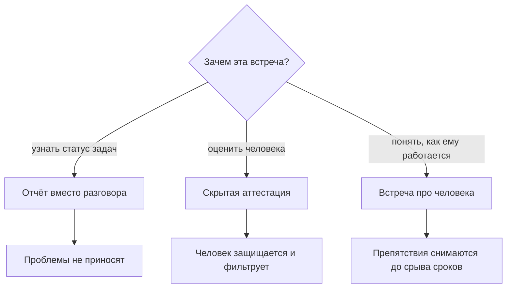
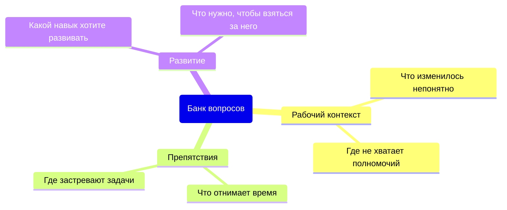

## Введение

Первые полгода встречи один на один у меня были отчётом с человеческим лицом. Я приходил со списком вопросов про задачи, инженер приходил с готовыми ответами, через полчаса мы расходились, и ни один из нас не сказал того, что действительно важно. Формально ритуал был: встреча стояла в календаре, проводилась регулярно, в ней даже фиксировались решения. Работать он начал только после того, как я поменял не расписание, а предмет разговора.

Тезис, к которому я пришёл: встреча один на один — ритуал про человека. Не про его задачи (они живут в трекере), не про его оценку (для этого есть наблюдаемые факты), а про то, как ему работается и что мешает. Превращённая в отчёт о статусе, встреча дублирует трекер; превращённая в аттестацию, она перестаёт получать правду.

Эта статья — про четыре вещи, которые удерживают формат: структуру, банк вопросов, границу личного и правила отмены. Она продолжает разговор о ритме лида — в статье «Ритм руководителя: правило 40 %» встреча один на один была одним из пяти обязательных ритуалов; здесь — как сделать так, чтобы этот час не был потерян.

## Два вырожденных формата

У встречи один на один есть два способа испортиться, и оба выглядят прилично со стороны.

**Отчёт о статусе.** Лид спрашивает: как дела с задачами, что с тем тикетом, когда закроешь этот. Инженер отвечает, лид записывает. Проблема не в содержании — проблема в том, что эта информация уже есть в трекере, а человек в такой встрече приносит только то, что безопасно принести. О препятствиях он не расскажет: препятствие — это признание, что не справляешься, а разговор идёт про сроки. Хуже того, статусная встреча дисциплинирует обратное: человек учится приходить с отчётом, а не с вопросом.

**Скрытая аттестация.** Лид не говорит «это оценка», но встреча устроена как оценка: расскажи, что у тебя не получилось, как ты оцениваешь свой уровень, почему ты не сделал то, что сделал бы на твоём месте я. Обратная связь здесь идёт в одну сторону и звучит как приговор. Итог предсказуем: человек начинает защищаться, готовит формулировки заранее и перестаёт приносить то, что может быть использовано против него. Через два месяца встречи становятся вежливыми и пустыми.

Схема выбора проста: у встречи должен быть один предмет, и он не может быть ни статусом, ни оценкой.

Дальше — как устроить разговор, у которого правильный предмет.

## Структура 40 минут

Формат, который у меня прижился, короткий: сорок минут и пять блоков. Важна не точность до минуты, а порядок: сначала человек, потом контекст, в конце — договорённости.

| Блок | Кто ведёт | Что должно остаться |
| --- | --- | --- |
| Что накопилось с прошлого раза | Инженер | Список тем, с которыми он пришёл |
| Препятствия | Инженер, лид разбирает | Одно-два препятствия с владельцем и сроком |
| Контекст и решения сверху | Лид | Понятное «почему», а не только «что меняется» |
| Развитие | Оба | Один следующий шаг по одному навыку |
| Итог | Лид | Решения с владельцем и датой |

Первая часть — его повестка, и здесь важно выдержать паузу. Если лид начинает со своих вопросов, дальше всё превращается в интервью. Работает простой ход: «с чего начнём — с того, что у тебя накопилось».

Вторая часть — препятствия, и это единственная часть, где лид не слушает, а действует. Препятствие — то, что мешает работать: нет доступа, непонятно, чья это задача, конфликт с соседней командой, инструкция устарела. Задача лида — не объяснить, почему так сложилось, а забрать препятствие с собой и вернуться с результатом.

Третья часть — контекст сверху: что меняется в компании, в продукте, в правилах и почему. Инженер, который понимает причину изменения, спорит с решением, а не саботирует его. Здесь же — решения, о которых нельзя говорить на общем разборе.

Четвёртая часть — развитие, и её легко провалить, если превратить в план на год. Достаточно одного навыка и одного следующего шага: что человек попробует до следующей встречи. Пятая часть — итог: два-три решения, у каждого владелец и дата.

Где фиксируются решения. Не в протоколе разговора — дословная запись делает людей осторожными. Достаточно строки в общем документе: что решили, кто сделает, к какому сроку. Личное не фиксируется, а решения, которые касаются других, пересказываются без атрибуции.

## Банк вопросов

Хороший вопрос на такой встрече не имеет готового ответа в трекере. Я держу банк из трёх групп и меняю его раз в несколько месяцев — вопросы, которые задаются годами, перестают вытаскивать что-либо, кроме вежливости.

Схема банка выглядит так: три группы, и у каждой — свой предмет.

Несколько формулировок из рабочего банка:

- Что за последние две недели отняло больше времени, чем ты ожидал?
- Где ты сейчас принимаешь решения без мандата — то есть спрашиваешь меня, хотя мог решить сам?
- Что я делаю такого, что мешает тебе работать?
- Какой навык тебе нужен, чтобы брать более сложные заявки, и что мешает начать?
- Что в правилах команды кажется тебе устаревшим?
- Чего ты ждал от этой роли и что оказалось не так?

<!-- вилка: 5–8 своих вопросов, которые реально работают в вашей команде. -->

Что в банке не работает: вопросы с готовой оценкой («тебе не кажется, что ты медленно закрываешь?»), вопросы-тесты («а как бы ты поступил на месте клиента?») и вопросы о прошлом, которое уже не изменить.

## Граница личного

На встрече один на один люди говорят не только о работе, и лид должен заранее понимать, что он делает с услышанным.

Провожу границу просто. Рабочие факты — то, что можно записать и передать: препятствия, договорённости, планы по навыкам. Личные признания — то, что человек рассказал о себе и своей жизни. Второе не записывается, не пересказывается и никогда не используется при оценке. Это не вежливость, а условие, без которого встреча работает в одну сторону.

Два уточнения, которые лучше проговорить вслух в самом начале, а не когда приспичило.

- Что я не могу держать в секрете. Есть вещи за рамками рабочего контекста — длительный больничный, угроза безопасности, нарушение закона, — которые нельзя оставить между двумя людьми. Обещать полную конфиденциальность, зная это, — обман, который в трудный момент выяснится.
- Что личное не станет рабочим. Если личные обстоятельства влияют на работу, обсуждается следствие, а не причина: перераспределение нагрузки, график, отсрочка, — без диагноза и подробностей.

Обратная сторона той же границы: лид не использует встречу как терапию для себя. Жаловаться инженеру на руководство, обсуждать с ним чужие проблемы или искать поддержку — способ лишить его возможности говорить о себе. Для таких разговоров у лида есть свои встречи с руководителем.

## Правила отмены

Самый частый способ убить этот ритуал — отменять его по уважительной причине. Инцидент, срочный запрос, встреча у руководства: в моменте всё выглядит логично, и через шесть недель встреч нет вообще.

Правила, которые работают у меня.

- **Перенос можно, отмену — нет.** Перенос означает конкретный новый слот, предложенный здесь же. «Ладно, на следующей неделе» слотом не является.
- **Если переносит лид — переносит редко и по одному разу.** Третий перенос подряд читается однозначно: он не важен. После третьего лучше сказать это словами и уменьшить частоту, чем продолжать обещать.
- **Если переносит инженер — это тоже сигнал.** Не потому, что он ленится, а потому, что разговор перестал быть для него полезным.
- **Пропущенная встреча не удлиняет следующую.** Догоняющие двухчасовые встречи не работают: они превращаются в тот самый отчёт, от которого мы уходили.

<!-- вилка: правила отмены в вашей практике — как часто переносили и что из этого следовало. -->

Встреча один на один стоит дорого — она забирает время у обоих. Но она единственная, где можно узнать о препятствии до того, как оно сорвало срок, и о выгорании до того, как человек написал заявление. Если этот час стабильно пропадает, начинать надо не с нового банка вопросов, а с правила отмены — и с честного ответа на вопрос, что вы на этой встрече делаете.
