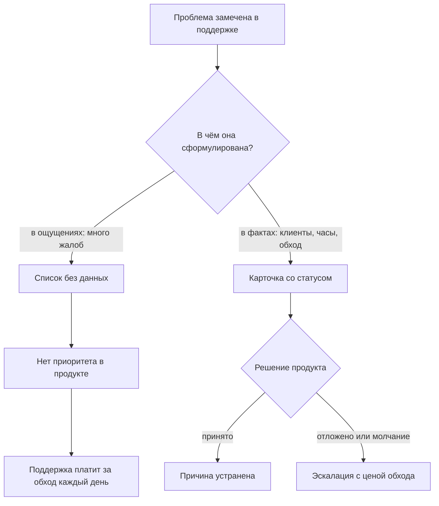
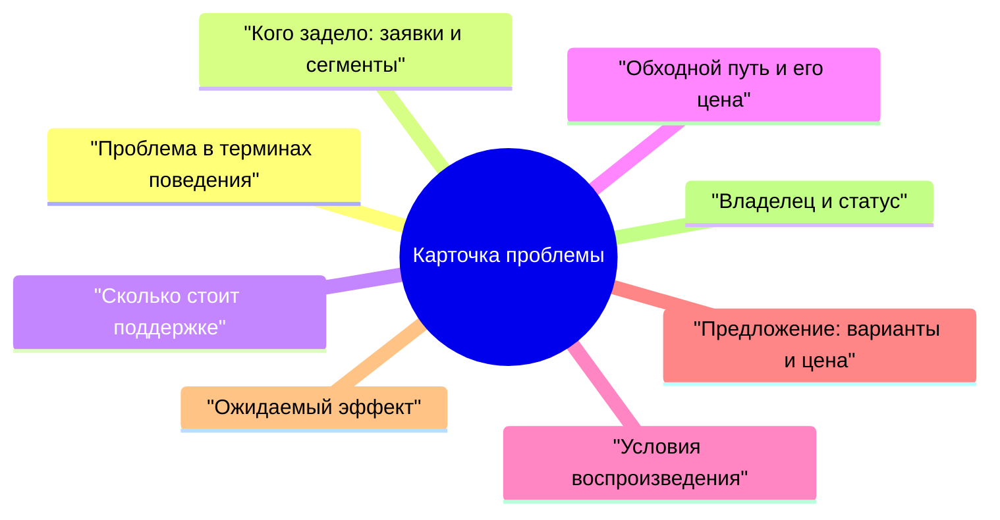
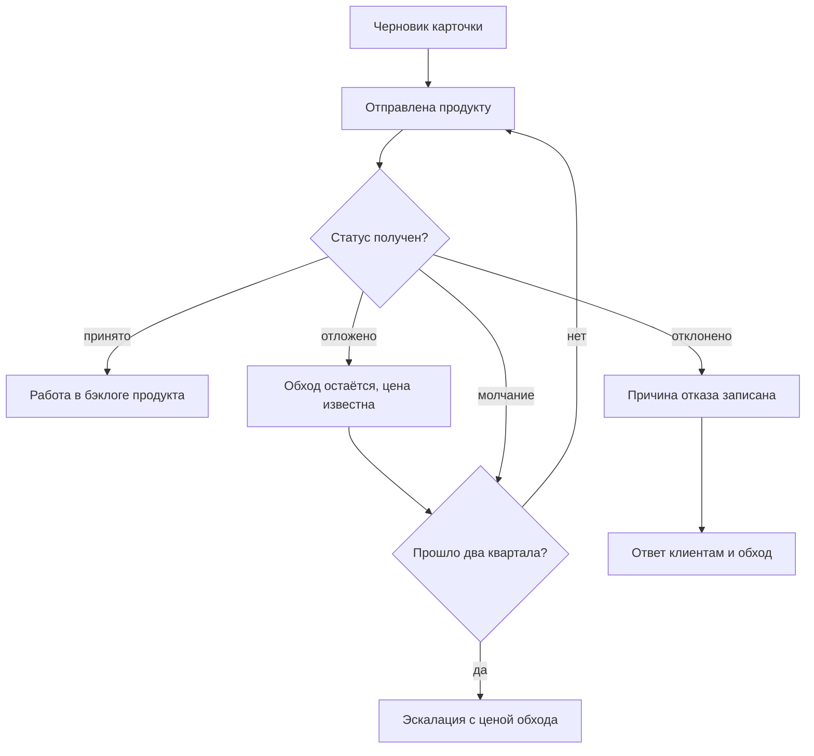

## Введение

Поддержка — единственное место в компании, где видно, что на самом деле ломается у клиента. Продукт смотрит на метрики, аналитику и план релиза; поддержка смотрит на людей, которые не смогли сделать свою работу. Между этими двумя картинами обычно нет канала, и проблема, о которой каждый день пишут в заявках, годами живёт в поддержке как «особенность продукта».

Я убеждён, что лид поддержки владеет самыми честными данными о проблемах клиентов в компании. Вопрос только в том, в каком виде эти данные выходят наружу. Формулировка «у нас много жалоб на выгрузку» не переживает первой встречи с планированием релиза, а карточка проблемы — переживает, потому что в ней есть клиенты, часы и цена обхода.

Blameless-разбор из прошлой статьи серии касался отдельного инцидента: сбой случился, его разобрали, действия получили владельцев. Эта статья о другом классе проблем — тех, что не закрываются одним действием, потому что решение лежит в продукте.

## Почему «у нас проблемы» игнорируется

Список болячек есть в каждой поддержке, и почти всегда он не работает. Дело не в том, что продукт не хочет слышать, а в том, что список не отвечает ни на один вопрос, который задаёт планирование.

- **У продукта своя очередь.** Приоритет определяется планом релиза и оценкой спроса, а не количеством сообщений в чате поддержки. Запрос без числа и сегмента проигрывает любой задаче, у которой есть оценка.
- **Проблема сформулирована как эмоция.** «Клиенты жалуются» не говорит, сколько клиентов, каких и что именно происходит. Продукт не может ни воспроизвести, ни оценить такую формулировку.
- **Не видна цена бездействия.** Пока поддержка не посчитала, сколько часов уходит на обход, проблема выглядит мелочью на фоне крупных задач.
- **Нет адресата.** Запрос без владельца на стороне продукта возвращается назад и умирает в переписке.
- **Нет статуса.** Проблема, которая «в работе», неотличима от проблемы, о которой забыли: через месяц никто не вспомнит, что уже решили.
- **Нет напоминания.** Сказали один раз — не повторили; через квартал никто не вспомнит ни проблему, ни того, кто её поднимал.

Развилка выглядит так:

Разница между ветками не в громкости жалобы, а в готовности приложить к ней числа и адресата. Дальше — из чего состоит эта работа.

## Анатомия карточки

Карточка — это не форма ради формы. Это минимальный набор сведений, при котором чужая боль становится задачей с оценкой. Я держу восемь полей:

| Поле | Что в нём | Зачем это продукту |
| --- | --- | --- |
| Проблема в терминах поведения | Что делает клиент и что получает вместо ожидаемого | Отделяет жалобу от сценария, который можно воспроизвести |
| Кого задело | Заявки, сегменты, критичность клиентов, частота | Даёт масштаб и основание для приоритета |
| Цена для поддержки | Часы и доля потока, повторные обращения | Показывает, сколько стоит бездействие |
| Обходной путь | Что инженеры делают вместо нормального решения и с каким риском | Показывает ручную работу, которую можно убрать |
| Условия воспроизведения | Окружение, версия, шаги, набор данных | Экономит продукту недели уточнений |
| Предложение | Варианты решения с ценой каждого | Переводит запрос из «почините» в выбор |
| Ожидаемый эффект | Что уйдёт из потока и что перестанет ломаться | Позволяет сравнивать с другими задачами |
| Владелец и статус | Имя человека в продукте, статус, дата следующего касания | Проблема перестаёт быть бесхозной |

Поля стоит разобрать не по порядку таблицы, а по тем, которые чаще всего заполняют неправильно.

**Кого задело.** Это первое, что спрашивает любой руководитель продукта. Ответ «все клиенты страдают» не проверяется и потому не весит ничего; ответ «вот список заявок, вот сегменты, вот повторные обращения» — проверяется и весит много. Важно не преувеличивать: одна раздутая цифра портит доверие ко всей карточке, и следующие пять нормальных карточек будут читать с подозрением.

**Цена для поддержки.** Считается не на глаз, а по событиям: сколько обращений в месяц по этой проблеме, сколько времени уходит на обход, сколько из них повторные. Даже грубая оценка по формуле «количество обращений умножить на среднее время обхода» сильнее, чем отсутствие оценки. Это единственный аргумент, который звучит в чужой системе приоритетов: не «клиентам неудобно», а «мы тратим столько-то часов в месяц на работу, которой не должно быть».

**Обходной путь.** Поле, которое чаще всего пропускают, а оно самое важное для разговора. Обход показывает две вещи: проблему уже решают руками, и это работает хуже, чем кажется. У обхода есть цена — время, риск ошибки, зависимость от конкретного инженера, — и именно она делает задачу продукта срочной.

**Предложение.** Поддержка вправе и должна предлагать решение: она видит сценарий чаще всех. Но предложение — это варианты с ценой, а не требование. «Можно поправить валидацию — это дешево; можно переделать форму — это дорого и закроет ещё две проблемы» даёт продукту выбор, а «сделайте нормально» — только раздражение.

**Владелец и статус.** Имя человека в продукте превращает карточку из письма в задачу. Не «команда продукта», а инженер или владелец направления, который взял карточку. Статус и дата следующего касания нужны, чтобы карточка не тонула.

Три правила, без которых карточка рассыпается: одна карточка — одна проблема (если внутри три причины, не движется ни одна); в карточке нет оценок людей и эмоций, только факты и сценарии; и всё, что записано, можно проверить по трекеру или документации.

<!-- вилка: поля своей карточки — как называется, где лежит, что реально заполняется, а что приходится вытаскивать руками. -->

## Ежеквартальный отчёт топ-причин

Карточки — это единица работы, а отчёт — способ показать их вместе. Раз в квартал я собираю страницу с топ-причинами: его читает тот, кто распределяет приоритеты продукта, и от него зависит, попадут ли эти проблемы в план.

Формат намеренно короткий: одна страница, без презентации, с таблицей по каждой причине.

- **Номер карточки и формулировка проблемы** — одна строка, в терминах поведения клиента.
- **Масштаб**: обращения за квартал и число затронутых клиентов.
- **Цена для поддержки**: часы и доля потока.
- **Тренд**: растёт, стабильно, снижается. Тренд важнее абсолютного числа: медленно растущая проблема через два квартала станет главной.
- **Статус и владелец** на стороне продукта.
- **Что просим**: решение или решение о приоритете, сформулированное как выбор.

Правила отбора в отчёт жёсткие и полезные:

- в отчёт попадают только карточки с данными — иначе это список желаний;
- сортировка по цене для поддержки, а не по дате появления: цель — расчистить поток, а не вести хронику;
- в отчёт входит блок «что уже сделано»: принятые и закрытые карточки. Без него встреча превращается в перечень претензий и теряет союзников;
- отчёт не повторяет резолюции прошлого квартала строка в строку: по каждой прошлой строке нужен статус.

Отчёт лучше готовить под конкретное решение. «Вот двадцать проблем» разбирать никто не будет; «вот пять, из которых две мы просим взять в квартал, по остальным просим решение об отсрочке» — обсуждаемо и заканчивается результатом.

<!-- вилка: формат своего отчёта — кому идёт, какой объём, что из него попало в план продукта. -->

## Статусы и эскалация молчания

Карточка без статуса превращается в письмо в никуда. Поэтому у статуса есть правила, и главное из них: статус ставит продукт, а поддержка отвечает за данные и сроки напоминаний.

Что стоит за этой схемой:

- **Молчание — не статус.** Если ответа нет в оговорённый срок, карточка получает отметку «молчание» с датой. Это не формальность: именно молчание съедает кварталы, а не отказы.
- **Отложено — не отказ.** У отсрочки есть причина и дата пересмотра. Без даты «отложено» — это вежливое «никогда».
- **Отклонено — тоже результат.** Причина записывается, поддержка сообщает клиентам и продолжает жить с обходом. Это честнее, чем тишина: обход становится видимым расходом.
- **Эскалация — с числами.** Если проблема отложена два квартала подряд, разговор идёт на уровень выше — не в формате «продукт нас не слышит», а с ценой обхода за период и риском. Просить решения, а не сочувствия, — отдельный навык, и он уже разобран в предыдущей части серии.

Отдельное правило — про то, чего в эскалации быть не должно. Карточки не используются как аргумент в спорах между командами или как способ показать, кто виноват в задержке. Как только карточка становится оружием, продукт начинает защищаться, а не читать данные, и канал закрывается.

<!-- вилка: как у вас устроены статусы — кто их ставит, сколько живёт карточка без ответа, был ли случай эскалации. -->

## Что меняется, когда карточки работают

Изменения видны не сразу и не только в цифрах — сильнее всего меняются разговоры.

Приоритет продукта перестаёт зависеть от громкости последнего письма. Появляется очередь, у которой есть основания: число клиентов и цена обхода. Спорить о такой очереди можно, но уже предметно — например, о том, какая цена считается выше.

Поддержка перестаёт быть единственным местом, где знают о проблеме. У неё появляется владелец на той стороне, а у лида — способ показать руководству, что происходит с потоком, не пересказывая заявки по одной.

Формируется история. Через год видно, какие проблемы решаются, какие закрываются отказом и что это значит для клиентов. Это самый убедительный аргумент при следующем разговоре о ресурсах: не обещания, а список решений и их последствий.

И меняется поведение инженеров. Когда у проблемы есть номер и статус, инженер первой линии перестаёт чувствовать, что пишет в пустоту: его наблюдения становятся данными. Это, пожалуй, самый дешёвый способ повысить вовлечённость, который я знаю.

<!-- вилка: история одной карточки — от записи до решения продукта: что было в данных, какой аргумент сработал, что изменилось после. -->

Карточка проблемы — не бюрократия, а минимальный формат, при котором боль клиента становится задачей с ценой и владельцем. Следующая статья серии — «Метрика без действия — это картинка: паспорт метрики» — о том, как убедиться, что числа, на которых стоят эти карточки, кто-то действительно использует для решений.
