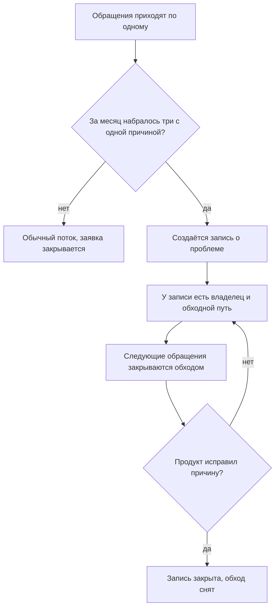
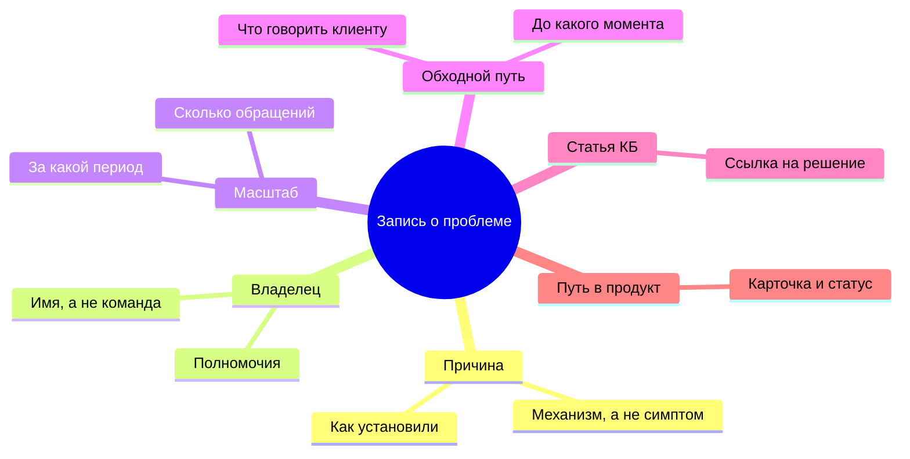

## Введение

Самый дорогой тикет в поддержке — тот, который команда уже решала. Не потому, что он сложный, а потому, что платит за него каждый раз другой инженер, и каждый раз заново.

Одно время я смотрел на отчёт и видел здоровье: поток закрывается, очередь не растёт, ни одного просроченного тикета. Потом слушал разбор недели и понимал, что три инженера рассказывают об одном и том же разными словами. В отчёте это были три успешно закрытые заявки; в реальности — одна проблема, которую никто не собирался решать.

Речь в этой статье о переходе, который стоит сервису больше всего: от потока заявок к списку проблем. Заявка — единица работы, и у неё есть срок. Проблема — единица причины, и у неё есть владелец, обходной путь и путь в продуктовый отчёт. Пока эти два списка не разделены, поддержка обречена решать одно и то же вечно.

## Невидимая стоимость одинаковых тикетов

Повторяющиеся обращения незаметны именно потому, что каждое из них выглядит нормально. Тикет пришёл, инженер разобрался, клиент получил ответ, заявка закрыта. Метрика «закрыто» растёт, а проблема не двигается.

Стоимость складывается из четырёх вещей, и ни одна не попадает в отчёт:

- **Часы команды.** Каждое повторение — это разбор с нуля: тот же поиск, те же проверки, те же эксперименты. Время списывается в операционку и не возвращается.
- **Доверие клиента.** Человек, который пишет третий раз за месяц и слышит «а вы пробовали…», делает вывод не про продукт, а про поддержку. Первый ответ ещё считается работой, третий — уже отпиской.
- **Знание, которое не оседает.** Инженер нашёл обход — и обход остался в его голове и в одном закрытом тикете. Через квартал он уйдёт в отпуск или в другую команду, и обход уйдёт вместе с ним.
- **Слепое пятно для продукта.** Пока проблема живёт тикетами, у продукта нет ни одного аргумента: ему нечего показать, кроме «клиенты жалуются». С записью о проблеме разговор меняется — но об этом ниже.

Всё это — цена отсутствия списка. Список начинается с правила, которое команда признаёт без обсуждений.

Почему такие повторы не видны в стандартном отчёте: он группирует заявки по категориям, а проблема живёт не в категории, а в причине. Две заявки в разных категориях могут иметь один и тот же механизм отказа, и никакая группировка их не сблизит. Поэтому искать повторы приходится не в дашборде, а на разборе недели и в поиске по текстам обращений.

## Правило трёх обращений

Правило простое: три обращения за месяц с одной причиной — не три тикета, а одна запись о проблеме. Одно обращение — случайность, два — совпадение, три — уже паттерн, с которым надо что-то делать.

В нём важны три уточнения, без которых правило превращается в формальность.

**Одна причина, а не один текст.** Совпадение формулировок ничего не значит: клиенты описывают одно и то же разными словами, а одно и то же слово может означать разные сбои. Считать надо по причине — по тому механизму, который инженер установил при разборе.

**Окно — месяц.** Год слишком долго: проблема успеет сожрать больше, чем стоит её решение. Неделя слишком коротко: часть проблем проявляется реже и не успеет набрать три обращения. Месяц — рабочий компромисс, и он же удобен как период обзора.

**Замечает любой, а не только лид.** Если три обращения замечает только лид, правило живёт ровно до первой загруженной недели. Триггер должен срабатывать на разборе недели, где команда сама называет повторы, а лид подтверждает — или на триаже, если в трекере есть поле для связи обращений.

Как это работает в потоке:

Обратите внимание на обратную стрелку: пока причина не исправлена, запись живёт и продолжает приносить пользу — именно этим она отличается от тикета.

<!-- вилка: как у вас работает правило трёх — кто замечает повторы, где ведётся список, что было до него. -->

## Анатомия записи о проблеме

Запись — не тикет и не заметка в чате. Это короткий документ, который живёт дольше любого обращения и читается теми, кто не участвовал в разборе. Вот набор понятий, из которых она состоит:

Поясню два блока, на которых чаще всего ломаются.

**Причина.** Формулировка должна описывать механизм: не «проблемы с доступом», а «после смены пароля старые сессии не инвалидируются». Такую причину можно проверить, передать продукту и закрыть. Формулировка через симптом проверке не поддаётся и годится только для поиска похожих тикетов.

**Владелец.** Имя человека, а не название команды. Владелец не обязан всё чинить сам: у него есть полномочия решать, что делать с проблемой, и он помнит контекст. Запись без владельца — это тот же тикет, только длиннее.

Остальные блоки служат читателю, а не бюрократии: масштаб показывает, стоит ли вкладываться; обходной путь даёт команде готовый ответ; статья в базе знаний превращает обход в переиспользуемое знание; путь в продукт делает проблему видимой там, где её могут устранить.

<!-- вилка: пример вашей записи о проблеме — причина, владелец, обходной путь, чем закончилась. -->

## Что даёт владелец

Главная выгода владельца не в том, что он быстрее реагирует. Она в том, что у проблемы появляется будущее.

Пока причины не исправлены, единственное, что может сделать поддержка, — дать клиенту рабочий ответ. Именно это и хранится в записи: обходной путь, проверенный и разрешённый, с границей «до какого момента он верен». Новый инженер не изобретает решение заново и не обещает того, чего не будет; клиент получает одинаковый ответ от любого сотрудника.

Второй эффект — экономия внимания лида. Без записи каждая повторная проблема возвращается к лиду заново: то в виде спора о приоритете, то в виде просьбы «посмотри, почему опять». С записью решение принято один раз и действует до изменения условий.

Третий — то, что видно снаружи. Список активных проблем с владельцами и статусами — лучший ответ на вопрос руководства «что происходит в поддержке». Он честнее графика закрытых заявок: показывает не активность, а состояние нерешённого.

Владельца при этом стоит брать из самой поддержки, а не из продукта. Владелец из поддержки знает клиентов и обход, принимает решения в своих границах и не ждёт чужого совещания; его задача — держать проблему в поле зрения, а не устранить причину своими руками. Если поставить владельцем продукт, запись умрёт: у продукта другой ритм, и поддержка снова останется без ответа.

<!-- вилка: сколько активных записей у вас одновременно и почему именно столько. -->

## Мост в продукт

Самая слабая часть этого механизма в большинстве команд — последний переход. Запись живёт внутри поддержки, а решение лежит в продукте; если между ними нет моста, запись превращается в вечный обходной путь.

Мост строится из того, что уже есть в записи: причина описана механизмом, масштаб известен, обход сформулирован. Из этого собирается карточка для продукта — с данными, статусом и владельцем на той стороне; о ней отдельно в статье «Карточка проблемы для продукта, которую не закрыть без статуса».

Правило, которое я считаю ключевым: запись о проблеме не закрывается по факту «мы отправили». Она закрывается, когда у неё появился внешний статус — принято в работу, отклонено с причиной, запланировано на версию. Отсутствие статуса — тоже статус, и его надо называть вслух на разборе.

<!-- вилка: пример пути от тикетов до карточки в продукте — что отправили, что ответили, чем закончилось. -->

И последнее. Список проблем живёт не в голове лида и не в треде чата, а в месте, доступном команде: иначе через месяц его придётся собирать заново. Неважно, таблица это или поле в трекере; важно, что его видит любой инженер до того, как начнёт разбирать очередное похожее обращение.
