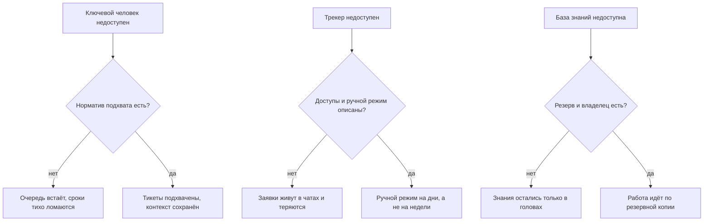
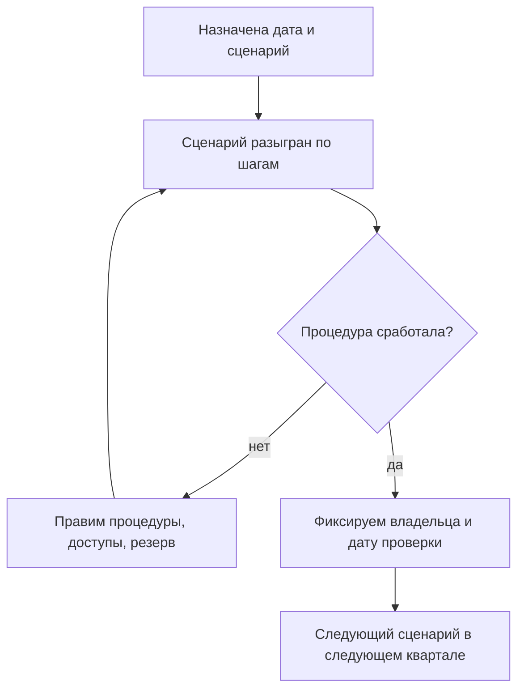

## Введение

У лида поддержки есть один честный тест на то, чем он на самом деле управляет: уйти и посмотреть, что останется. Не «справятся ли ребята» — они почти всегда справляются, — а с какой скоростью сервис начнёт терять заявки, обещания и контекст.

В предыдущей статье серии — «Метрика без действия — это картинка: паспорт метрики» — речь шла о том, чтобы у каждой цифры было действие. Эта статья — последняя проверка года: что произойдёт с сервисом, если из него вынуть конкретного человека. Называю эту проверку аудитом живучести. Это не про доверие к команде и не про поиск виноватых, а про поиск точек отказа до того, как отказ случится: в отпуске, на больничном, в день увольнения или в день, когда трекер лёг вместе с доступом к нему.

Тезис, из которого я исхожу: живучесть — это свойство системы, а не характера людей. Пока знание, маршрут и решение живут в одном человеке, сервис работает на его присутствии, а не на регламенте. Аудит нужен, чтобы увидеть этот разрыв в спокойное время, когда исправление стоит часа, а не репутации.

## Три сценария провала

Сценариев, которые стоит разыграть, много, но почти все сводятся к трём. Первый — недоступность ключевого человека: отпуск, болезнь, внезапный уход, две недели без связи. Второй — отказ инструмента: трекер недоступен, доступ отозван, интеграция сломана, почта не разбирается. Третий — потеря базы знаний: она устарела, она недоступна, её некому поддерживать, и знания вернулись туда, откуда мы их весь год вытаскивали — в головы.

Общее у них одно: каждый сценарий проверяет не героизм команды, а наличие норматива и владельца. Схема показывает, как сценарий расходится на два исхода:

Разница между верхней и нижней веткой каждого сценария — не в людях, а в том, существует ли заранее написанный ответ. Дальше разбираю норматив, который делает первый сценарий безобидным, и расчёт, который его проверяет.

## Норматив «подхват за 15 минут»

Норматив, на котором держится вся живучесть, звучит так: любая новая заявка подхвачена в течение пятнадцати минут в рабочее время. Подчёркиваю, что значит «подхвачена»: у заявки есть владелец, проставлены категория и критичность, клиент получил первый содержательный ответ или хотя бы честный срок. Подхват — это не решение. Требовать решения за пятнадцать минут бессмысленно; требовать, чтобы заявка не висела безымянной, — обязательно.

Что должно существовать, чтобы норматив выполнялся без конкретного человека:

- **Триаж при первом касании.** Категория, критичность и маршрут проставляются при приёме, а не после того, как заявка полежала. Без этого «подхват» превращается в «кто-нибудь посмотрел».
- **Дежурство с ротацией.** У очереди есть конкретный дежурный на каждый день, и его имя известно команде. Дежурный меняется по календарю, а не по договорённости в чате.
- **Матрица маршрутов.** Для типовых поводов записано, к кому уходит заявка: линия L2, продукт, эксплуатация, внешний подрядчик. Если маршрут держится в голове лида, подхват невозможен по определению.
- **Доступ у всех, кому он нужен.** Очередь, база знаний, регламенты и шаблоны ответов открываются не по личной просьбе, а по роли. Человек, который «знает, у кого попросить доступ», — это и есть одноточечный риск.
- **Эскалация с таймером.** Если заявка не подхвачена за норматив, это видно: дежурный получает сигнал, а не узнаёт о нарушении на еженедельном разборе.

<!-- вилка: ваш норматив подхвата — значение, часы работы, что считается подхватом и как фиксируется. -->

Отдельно стоит договориться, что норматив действует в рабочее время. Круглосуточный подхват — это другая модель смен и другой штат; обещать его без ресурса значит закладывать тихое нарушение в собственный регламент.

## Проверка нормативов расчётом

Норматив легко объявить и трудно доказать. Проверяется он расчётом мощности из статьи «Мощность вместо героизма»: объём потока за период, умноженный на среднее время обработки одной заявки, делённый на доступные часы команды. Пока расчёт сходится при полном составе, всё выглядит благополучно. Аудит живучести добавляет к нему один вопрос: сходится ли расчёт, если вычесть одного человека — и особенно если вычесть именно того, кто держит самый тяжёлый участок.

Считать нужно по трём вычетам.

1. **Минус ключевой инженер.** Доступные часы уменьшаются, а поток остаётся. Если после вычета норматив подхвата не выполняется даже на бумаге, никакой героизм его не выполнит и в жизни.
2. **Минус лид.** Если поток сходится только при вашем участии, значит часть работы — маршрутизация, споры о критичности, согласования — не передана. Это те самые роли, от которых вы вроде бы отказались, но только в документе.
3. **Минус инструмент.** Отказ трекера стоит не часов, а дней: пока заявки идут почтой, время первого ответа считается по другому правилу. В расчёте это выглядит как падение производительности на период восстановления — и этот период должен быть оценён заранее.

Второй способ проверки — по событиям, а не по модели. Берутся дни, когда ключевой человек отсутствовал, и по трекеру смотрятся заявки, пришедшие в эти дни: время до первого ответа, доля заявок, переназначенных повторно, число реопенов после возвращения человека. Если в такие дни сроки растут, а после возвращения заявки закрываются повторно, проблема не в людях, а в передаче контекста.

<!-- вилка: свой расчёт — сколько заявок в неделю, среднее время, доступные часы, что показал вычет одного человека. -->

## Процедуры восстановления

Аудит бесполезен, если заканчивается списком рисков. Каждый найденный риск получает процедуру — короткую, на страницу, с владельцем и датой проверки.

- **Передача дел.** Чек-лист на неделю отсутствия: какие заявки в работе, какие обещания даны клиентам, где ждут ответа, кого предупредить. Заполняется до отпуска, а не в первый день больничного.
- **Реестр доступов и аварийный вход.** Список систем и ролей, которые нужны для работы очереди, и порядок получения доступа в обход обычного согласования — с условиями, при которых он применяется, и с записью о применении.
- **Резерв базы знаний.** Владелец базы, периодичность выгрузки, где лежит копия и как она разворачивается. Проверка резерва — восстановление одной статьи, а не галочка в регламенте.
- **Ручной режим при отказе трекера.** Адрес, куда пишут клиенты, шаблон ответа, кто разбирает входящее, сколько такой режим выдерживает и как заявки потом переносятся в трекер.
- **Порядок объявления.** Кто и в какой момент сообщает команде и клиентам, что режим изменился, и кто принимает решение вернуться в обычный.

<!-- вилка: ваши процедуры — что уже написано, что проверялось на практике и чем закончилось. -->

## График аудита

Аудит живучести — не разовое мероприятие, а ритм. Минимальная частота, которая работает: раз в квартал по одному сценарию, с полной процедурой разбора. Один квартал — недоступность человека, следующий — отказ инструмента, третий — потеря знаний, четвёртый — сценарий, который выбрала команда.

Как выглядит цикл:

Главная ловушка графика — превратить аудит в театр: разыграть сценарий, убедиться, что «в целом все справились», и ничего не изменить. Поэтому у каждого аудита должен быть хотя бы один видимый результат: обновлённая процедура, новый доступ, выгруженный резерв или снятый с повестки риск. Аудит без изменения — это не проверка живучести, а отчёт о спокойствии.

Кого привлекать: второго инженера, который умеет работать в этом участке, представителя смежной команды, если сценарий затрагивает её, и руководителя — не для отчёта, а чтобы он увидел точки отказа своими глазами. Что обновляется по итогам: норматив подхвата, реестр доступов, резерв базы знаний, календарь дежурств и сам список рисков.

<!-- вилка: результаты вашего аудита — какие точки риска нашли, что закрыли, что осталось открытым. -->

Живучесть нельзя доказать презентацией. Её доказывает один факт: сервис работает, когда вас нет, и никто не выясняет по ходу дела, где лежит нужный доступ. Год, который заканчивается таким фактом, можно считать удавшимся — и следующий планировать от него, а не от пожеланий. Об этом — в последней статье серии: «Девять ошибок лида поддержки — и годовой отчёт».
