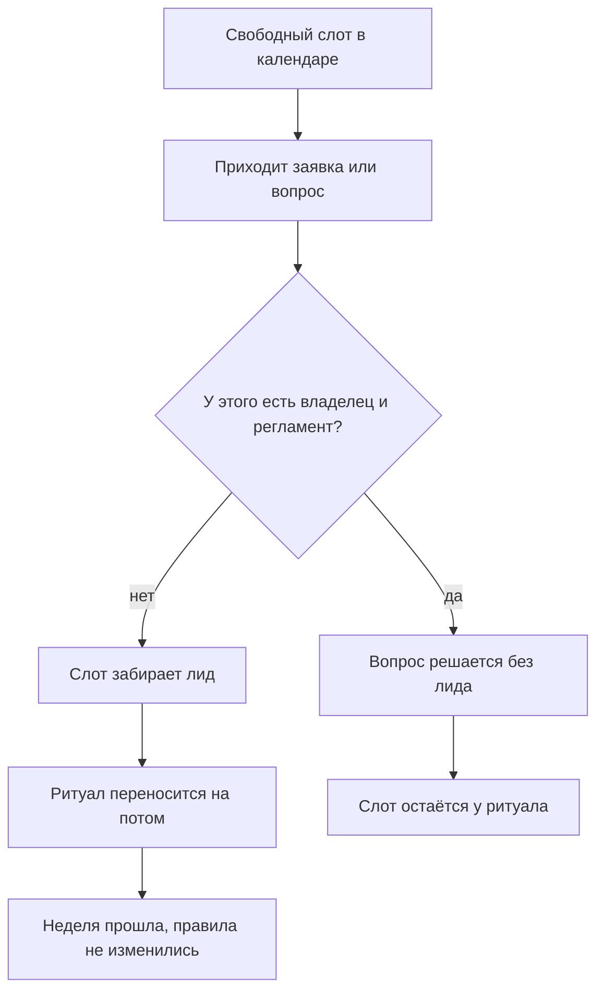
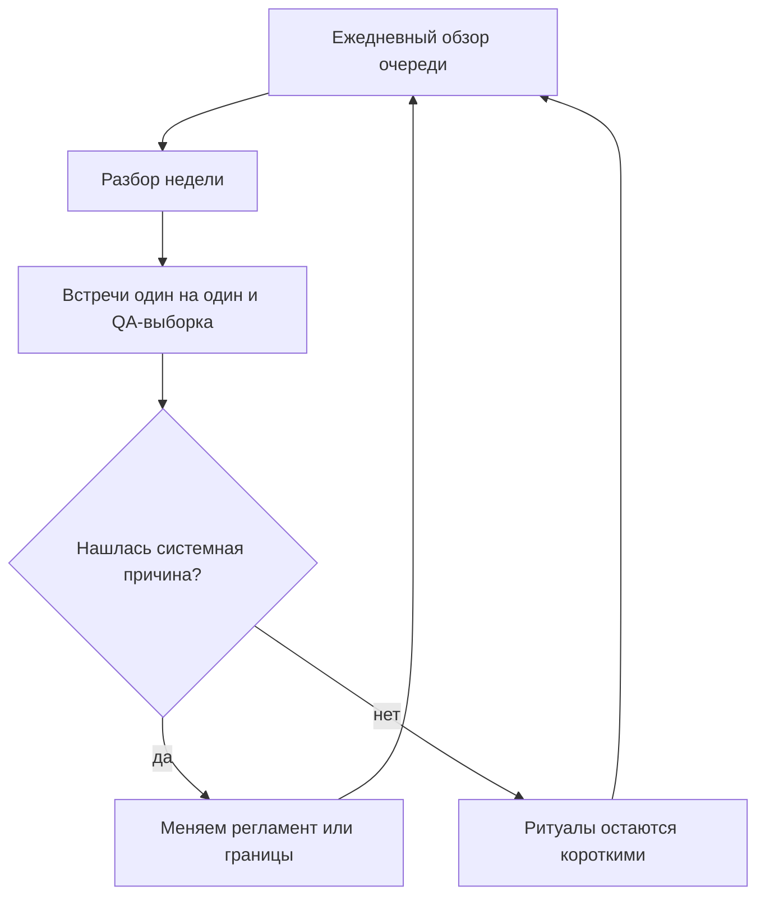

## Введение

Я долго считал, что главная проблема лида поддержки — нехватка времени и лечится она дисциплиной: раньше вставать, плотнее планировать день, меньше отвлекаться. Через несколько лет выяснилось обратное. Времени хватает. Уходит оно не туда.

День лида заполнен работой, которую кто-то должен делать, — вопрос только в том, кто именно. Чистка очереди, ответы на «а как тут поступить», согласования переносов, разбор зависших заявок: всё это работа, и она не ждёт. Ритуалы, ради которых роль существует, тоже стоят в календаре — обзор очереди, разбор недели, встречи один на один, выборка качества, статус руководству. Проблема в том, что поток не признаёт календарь: первым съедается именно то, что не горит сегодня, то есть ровно ритуалы.

Отсюда формулировка, которую я держу в годовом плане и считаю главным ограничением своего расписания: обязательные ритуалы имеют право занимать не больше 40 % рабочего времени. Не «желательно», не «постарайтесь» — бюджет. Всё, что выше, вычитается из другой строки, а эта строка — изменения, развитие людей и договорённости с руководством. В дорожной карте года она названа прямо: на то, что не горит сейчас, нужно не меньше двух дней в неделю.

Дальше — как посчитать свою неделю без самообмана, что входит в минимальный ритм, откуда взялось число 40 и что сокращать первым, когда оно всё равно не сходится.

## Где уходит неделя лида

Считать надо не по памяти. В пятницу память услужливо подсунет неделю пожаров и вычеркнет четыре часа встреч, на которых вы молчали. Я записывал иначе: в конце дня три-четыре слова в заметку — на что ушёл день, в конце недели — расклад по категориям.

Расклад почти всегда получается из шести строк: пожары и чистка очереди; ответы на вопросы команды; согласования и разрешения; встречи, которые ведут другие; отчёты и статусы; и последняя строка — то, ради чего роль существует: правила, качество, люди, договорённости.

Из такого расклада видны две вещи, которые трудно увидеть иначе. Первая: половина строк — не работа лида, а работа, которую некому было взять. Вторая, более неприятная: ритуалов в этом раскладе нет отдельной строкой — они растворены внутри пожаров, потому что обзор очереди превращается в разбор конкретной заявки, а встреча один на один — в разбор статуса по проекту. Ритуал, съеденный по дороге, не оставляет следа, и по итогам недели кажется, что его и не было.

<!-- вилка: свой расклад недели — 4–6 категорий и их доли. -->

Если вести записи не хочется, есть косвенные признаки. Календарь плотный, а вспомнить, какое решение про качество вы приняли на прошлой неделе, невозможно. Инженеры приносят проблемы, когда они уже случились. Отчёт руководству собирается из переписки в последний вечер. Любой из этих признаков означает одно и то же: ритуалы перестали быть работой и стали тем, что делают, если останется время.

Как выглядит эта утечка, видно на схеме: свободный слот в календаре не пустует — он заполняется входящим.

Схема показывает главное: утечка происходит не в момент, когда вы решили не проводить ритуал, а раньше — когда слот занял входящий, у которого не было владельца. Поэтому лечится она не силой воли, а границами: если у решения есть владелец и регламент, оно не обязано проходить через лида. Об этом подробнее — в статье [«Границы ответственности»](/ru/blog/support-lead-boundaries/).

## Минимальный ритм руководителя

Минимальный набор ритуалов у меня состоит из пяти позиций, и каждая отвечает на вопрос, которого иначе некому задать.

**Обзор очереди — ежедневно, в начале дня.** Это не разбор заявок, а взгляд на отклонения: что висит дольше норматива, что переоткрылось, где очередь растёт быстрее обычного. Разбор заявок — работа инженеров; обзор очереди — работа лида, потому что он видит поток целиком и может изменить правила, а не только закрыть одну заявку.

**Разбор недели.** Один регулярный блок, на котором смотрят не заявки, а повторяющиеся причины: что ломалось чаще всего, где решение принималось дважды, какие правила не сработали. Это единственное место, где решения становятся системными.

**Встреча один на один.** Ритуал про человека, а не про статус задач; его устройству посвящена отдельная статья серии — «1:1, которые не превращаются в отчёт и аттестацию».

**QA-выборка.** Несколько закрытых заявок, прочитанных целиком, — единственный способ говорить о качестве не по впечатлениям. Как устроена выборка и по каким критериям читается заявка, разобрано в статье «Оценка по наблюдаемым фактам».

**Статус руководству.** Регулярный, по одной и той же форме. Его смысл не в отчётности, а в том, чтобы ресурс и решения просили заранее, а не в момент аварии.

| Ритуал | Каденция | Что теряется без него |
| --- | --- | --- |
| Обзор очереди | Ежедневно, в начале дня | Отклонения замечаются, когда их уже разгребают |
| Разбор недели | Раз в неделю | Решения принимаются по одному, системные причины не видны |
| Встреча один на один | Раз в неделю или раз в две недели | О проблеме узнают, когда она уже случилась |
| QA-выборка | Каждую неделю | Качество обсуждается по впечатлениям и памяти |
| Статус руководству | Регулярно, в согласованной форме | Ресурс просят в момент аварии, и его не дают |

Почему пять, а не пятнадцать. У ритуала есть два признака: у него есть владелец и у него есть результат, который видно снаружи. Собрание, после которого ничего не изменилось, — не ритуал, а привычка. Пятнадцать ритуалов гарантируют, что половина из них именно такие, и съедят весь бюджет.

## Правило 40 %

40 % рабочего времени — это примерно два дня из пяти. Столько имеют право стоить ритуалы. Не потому, что это красивая доля, а потому, что остальное время нужно на работу, которую нельзя сделать между делом: изменения, развитие людей, разговор с руководством, разбор того, что не работает.

Порог именно такой, а не 60 или 80, по трём причинам.

- **Ритуалы обслуживают систему, а не развивают её.** Они показывают, что происходит, но не меняют правил. Если всё время уходит на наблюдение, менять правила некому.
- **Ритуал растягивается до отведённого времени.** Разбор недели, у которого нет конца, превращается в разбор одной заявки на всех. Ограничение держит форму.
- **Выше половины недели лид начинает оптимизировать ритуалы вместо сервиса.** Появляются более красивые отчёты, более подробные протоколы, более частые встречи — и ни одного изменения в правилах.

Измерять это лучше тем же недельным раскладом, а не трекером: трекер покажет заявки, а вам нужны часы. Если по итогам двух-трёх недель ритуалы съедают больше 40 %, правильный вопрос не «как ускориться», а «что из входящего не должно идти через меня». Ответ на него почти всегда лежит в границах и регламентах, а не в календаре.

Как замыкается цикл, ради которого ритуалы существуют:

Смысл цикла в последнем шаге: если ритуалы не приводят к изменению правил, они действительно только съедают время — и тогда их надо не защищать, а переделывать.

## Иерархия жертв

Неделя не сходится регулярно, и это нормально: инциденты не согласуются с календарём. Плохо не то, что приходится чем-то жертвовать, а то, что жертва выбирается случайно — первым падает то, что стоит в календаре последним. Поэтому жертвы стоит упорядочить заранее.

1. **Формат, а не содержание.** Отчёт-презентация становится письмом, встреча-синк — сообщением в канале, подробный протокол — тремя строками решений. Содержание остаётся, цена падает.
2. **Встречи, которые дублируют письменное.** Если итог встречи можно было прочитать, встреча не нужна.
3. **Глубина разбора недели.** Он может стать короче, но не может исчезнуть: без него решения снова принимаются по одному.
4. **Перенос встречи один на один.** И только по правилам: переносить можно, отменять нельзя. Если переносы идут третью неделю подряд, дело уже не в календаре.

Что не сокращается никогда — обзор очереди, QA-выборка и разбор недели. У них неприятное свойство: их отсутствие не видно месяц. Очередь выглядит нормально, пока не выясняется, что половина заявок висит за нормативом; качество кажется приемлемым, пока клиент не уходит. Именно поэтому они первые в списке на сокращение и последние, кому это можно позволить.

## Неделя в двух режимах

Разница между неделей с правилом и без него не в количестве сделанного, а в том, кто определяет день.

| Признак | Неделя без правила | Неделя с правилом |
| --- | --- | --- |
| Что определяет день | Входящий поток | Календарь ритуалов и решений |
| Где принимаются решения | В чатах и по одному | На разборе недели, с владельцем |
| Что видно в пятницу | Список закрытых заявок | Что изменилось в правилах |
| Откуда берётся время сверх бюджета | Из изменений и людей | Ниоткуда: бюджет не растёт |
| Что происходит в отпуске лида | Очередь встаёт | Ритуалы выполняет второй человек |

<!-- вилка: своё расписание ритуалов — дни, длительность, кто подстраховывает в отпуске. -->

Последняя строка в таблице важнее остальных. Ритм, который держится только на вас, — не ритм, а ещё одна форма одноточечного риска. Поэтому в расписании ритуалов стоит сразу записать второго человека: кто ведёт обзор очереди, когда вас нет, кто собирает статус, кто читает выборку. Это не делегирование роли, а страховка на две недели отпуска, и она проверяется просто: уйдите в отпуск и посмотрите, что из ритуалов выжило.

Правило 40 % — не про то, чтобы работать меньше. Оно про то, что управление имеет цену, и эту цену лучше платить регулярно и небольшими порциями, чем один раз, когда выяснится, что год прошёл в диспетчеризации. Всё, что сверх порога, оплачивает сервис: изменениями, которые не случились, и людьми, которые не выросли.
