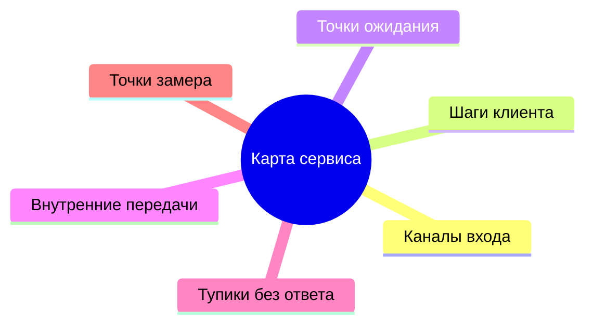
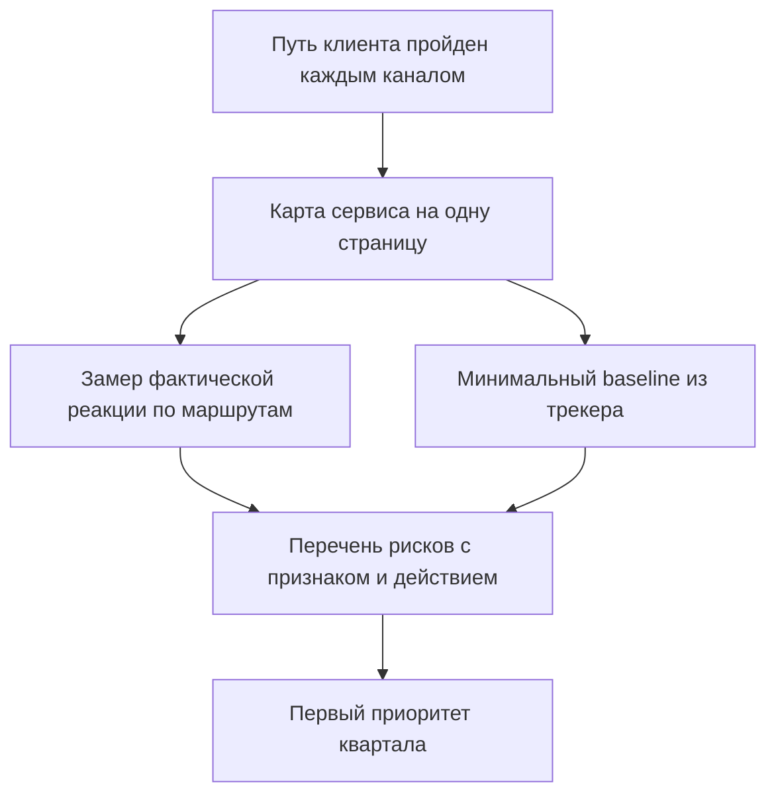

## Введение

Первый месяц в роли лида поддержки я потратил на регламенты: читал, сверял, задавал вопросы. В регламентах жил аккуратный сервис — заявка приходит в трекер, попадает в правильную очередь, инженер отвечает в срок, клиент доволен. В жизни жил другой сервис: половина обращений начиналась в чате с фразы «а можно вопрос», часть запросов вообще не доходила до трекера, а сроки, которые все считали выполненными, считались по определению, которого никто не помнил.

Разрыв между этими двумя сервисами — не признак плохой команды. Это нормальное состояние системы, которую никто никогда не описывал целиком: каждый её кусок появился в своё время, под свою задачу и своего клиента. Проблема начинается позже — когда лид приходит с планом улучшений, а плана некуда приложить, потому что неясно, что именно улучшается.

В предыдущих статьях серии речь шла о времени лида ([«Границы ответственности»](/ru/blog/support-lead-boundaries/)), о логике точки А («Baseline раньше целей») и о том, как из целей собирается год («Год лида по кварталам»). Эта статья — о шаге, который предшествует всем трём: как за первые недели получить описание сервиса и его точку А, не имея ни времени, ни данных, ни согласия на большие изменения.

Тезис такой: диагностика первого месяца отвечает на два вопроса — что видит клиент, когда идёт к решению, и сколько он на каждом шаге ждёт на самом деле. Первый ответ даёт карта сервиса, второй — замер фактической реакции. Вместе они превращаются в артефакты, с которыми уже можно разговаривать о целях.

## Пройти путь клиента каждым каналом

Первое упражнение стоит времени и выглядит странно: напишите в свою поддержку как клиент. Не «проверьте, работает ли форма», а пройдите путь целиком — почтой, через портал, по телефону, в чате, — и запишите, что происходит.

Что видно в этом упражнении и не видно изнутри:

- **Сколько нужно знать, чтобы просто отправить обращение.** Где на сайте написано, куда писать? Требует ли форма номер договора, который клиент не помнит? Просит ли выбрать категорию из списка, в котором нет его случая?
- **Что приходит в ответ на отправку.** Автоответ с номером заявки, письмо «мы получили ваше обращение», тишина. Автоответ — не формальность: именно он говорит клиенту, что его услышали, и именно его отсутствие рождает второе письмо и звонок.
- **Видит ли клиент статус.** Может ли он узнать, что с его заявкой, не написав ещё раз? Если нет, каждый статус превращается в новое обращение и новую единицу нагрузки.
- **Что происходит, когда он молчит.** Клиент не ответил на уточняющий вопрос: заявка ждёт его, инженера или никого? Ответ на этот вопрос часто объясняет половину «старых» тикетов.
- **Где путь обрывается.** Форма отправляется в пустоту, телефон в нерабочие часы говорит «перезвоните позже», чат закрывается без ответа.

Всё, что вы записали, складывается в одну страницу. Её структура простая и одинаковая для любого сервиса:

- **каналы входа** — откуда приходят обращения и какой канал главный;
- **шаги клиента** — что от него требуется на каждом этапе;
- **точки ожидания** — где он ждёт и чего именно;
- **внутренние передачи** — где заявка переезжает между людьми, очередями и системами;
- **тупики** — места, где обращение может остаться без ответа;
- **точки замера** — где в этом пути есть событие, по которому можно посчитать время.

Так выглядит набор элементов, которые нужно нанести на карту:

Карта без цифр — это ещё не диагностика, а список мест, где цифры нужно снять. Но у неё уже есть практическая польза: на ней видно, что «поддержка» — не одна очередь, а несколько маршрутов с разной скоростью и разными правилами. Дальше становится понятно, что мерить нужно не «сервис в целом», а каждый маршрут отдельно.

Отдельно пройдите путь, который клиент проходит после решения: закрытие заявки, письмо с итогом, повторное обращение по той же теме. Второй круг того же вопроса — самый честный показатель качества, и он почти никогда не описан в регламенте.

## Замер фактической реакции

Второй шаг — измерить, сколько клиент ждёт на самом деле. Не по нормативу и не по ощущению инженеров, а по событиям в трекере: от создания заявки до первого содержательного ответа и от создания до закрытия.

Три правила, без которых замер превращается в спор о словах.

**Первое: определение раньше числа.** «Первый ответ» — это автоответ, шаблонное подтверждение или сообщение, в котором есть ответ по существу? Пока определение не записано, цифру можно трактовать как угодно, и каждая сторона будет права. То же с «решением»: закрытие по инициативе инженера, по подтверждению клиента или по истечении срока — это три разных события.

**Второе: клиент ждёт не среднее.** Среднее время ответа скрывает хвост: если большинство заявок закрывается быстро, а часть висит неделями, среднее останется приличным, а клиенты будут помнить именно недели. Поэтому рядом со средним нужен девяностый процентиль — время, за которое закрывается девять заявок из десяти. Хвост и есть то, что портит репутацию сервиса.

**Третье: время в работе и время в ожидании — раздельно.** Заявка, которая ждёт ответа клиента, и заявка, которая ждёт свободного инженера, выглядят в отчёте одинаково и означают противоположное. Если их не разделить, виноватым в сроках автоматически становится или клиент, или команда — в зависимости от того, кто делает отчёт.

Что получается на выходе — небольшая таблица по каналам и маршрутам: медиана и девяностый процентиль первого ответа, то же для решения, доля заявок, у которых первого ответа не было вовсе. Несколько строк, которые уже можно показать руководству и обсудить без эмоций.

<!-- вилка: цифры фактической реакции по каналам — медиана и p90 первого ответа и решения, доля заявок без первого ответа. -->

Здесь же обычно обнаруживается первая неприятная вещь: часть потока не имеет заявки вообще. Вопросы в общем чате, звонки на личный номер, просьбы, переданные через коллег. Эти обращения невидимы для метрик, но занимают время команды — и именно они объясняют, почему инженер «занят, а заявки не закрываются».

## Baseline из трекера

Третья часть диагностики — выгрузка из трекера. Здесь легко утонуть: полей много, отчётов ещё больше, и первая попытка «сделать нормальный дашборд» обычно заканчивается дашбордом, которым никто не пользуется.

Полный список полей и правил выгрузки я разбирал в статье «Baseline раньше целей». В первый месяц достаточно четырёх разрезов, и у каждого есть конкретный вопрос, на который он отвечает.

| Разрез | Вопрос, на который отвечает | Что делать с ответом |
| --- | --- | --- |
| Объём и структура потока | Сколько обращений и какого рода: инциденты, вопросы, запросы на изменение | Понять, какие маршруты вообще нужны |
| Критичность | Как распределены приоритеты и какая доля заявок считается критичной | Найти очередь, которая держит риск |
| Возвраты и реопены | Какая доля заявок открывается повторно | Отделить скорость от качества решения |
| Возраст бэклога | Сколько заявок висит дольше норматива | Увидеть тихие нарушения и накопленный долг |

Четыре разреза не заменяют полноценный baseline, но дают главное — понимание масштаба и одну-две гипотезы о том, где узкое место. Гипотезы важны именно в этот момент: с ними можно идти к команде с вопросом, а не с обвинением.

<!-- вилка: собственные выгрузки первого месяца — какие разрезы взяли, за какой период, где лежит таблица. -->

Есть смысл сразу договориться о двух правилах, которые сэкономят месяцы споров. Первое: все цифры считаются за одно окно из одного источника. Второе: определения записаны рядом с таблицей. Не потому, что этого требует методика, а потому, что через квартал вы будете сравнивать новую цифру со старой, и вопрос «а как считали тогда» должен иметь ответ в документе, а не в чьей-то памяти.

## Перечень рисков

Последняя часть диагностики — перечень рисков. Это не реестр на сто строк и не формальная оценка вероятностей. Это короткий список того, что сломается первым, когда поток вырастет или когда из строя выйдет один элемент.

Метод простой: пройдите по карте сервиса и задайте каждой точке три вопроса.

- **Что будет, если объём вырастет вдвое?** Не «станет тяжелее», а конкретно: какая очередь встанет первой, какой канал перестанет отвечать в срок, где ручная операция превратится в бутылочное горлышко.
- **Что будет, если один человек исчезнет на две недели?** Не только инженер: владелец интеграции, единственный, кто умеет выгружать отчёт, автор регламента.
- **Что будет, если откажет внешняя система?** Трекер, почтовый шлюз, портал, телефония. Часть маршрутов после отказа не восстанавливается вообще — обращения просто теряются.

Ответы складываются в список из трёх-пяти позиций. У каждой — признак, по которому видно, что риск начал реализовываться, и первое действие. Именно этот список, а не общий призыв «повысить надёжность», становится повесткой первого квартала.

<!-- вилка: три главных риска из собственного перечня — что сломается первым при росте потока и почему. -->

Полезно сразу отделить риски, которые лечатся внутри поддержки, от тех, что требуют решений за её пределами. Первые попадают в план команды, вторые — в разговор с руководством: часть из них стоит денег, часть — изменения процессов в других подразделениях. Если этого разделения нет, перечень рисков остаётся списком жалоб.

## Артефакты первого месяца

Четыре части диагностики не живут по отдельности: каждая опирается на предыдущую и без неё теряет смысл.

К концу первого месяца у лида должно быть четыре вещи, и ни одна из них не требует бюджета.

- **Карта сервиса на одну страницу.** Каналы, шаги клиента, ожидания, передачи, тупики, точки замера. Она нужна не для отчёта: с ней разговор о приоритетах перестаёт быть разговором о вкусах.
- **Таблица фактической реакции.** Медиана и девяностый процентиль по каждому маршруту, отдельно время в работе и время в ожидании.
- **Минимальный baseline.** Четыре разреза из трекера за одно окно, с записанными определениями.
- **Перечень рисков.** Три-пять позиций с признаком и первым действием, разделённые на «внутри поддержки» и «нужно решение вовне».

Эти четыре артефакта — не диагностика ради диагностики. Они отвечают на вопрос, который рано или поздно задаст любой руководитель: «что происходит в сервисе». И отвечают не впечатлением, а описанием.

Дальше начинается работа, которая делается один раз и потом только поддерживается: маршрутизация обращений. Диагностика показала, что маршрутов несколько и они разные; следующий шаг — сделать так, чтобы каждое обращение попадало в свой маршрут с первого касания, а не после двух передач и одного возврата. Об этом — в статье «Триаж при первом касании: категория, критичность, маршрут».

Хорошая диагностика заканчивается не документом, а фразой «теперь понятно, что делать первым». Если после месяца работы такой фразы нет, значит, вы описали сервис, но не посмотрели на него глазами клиента.
