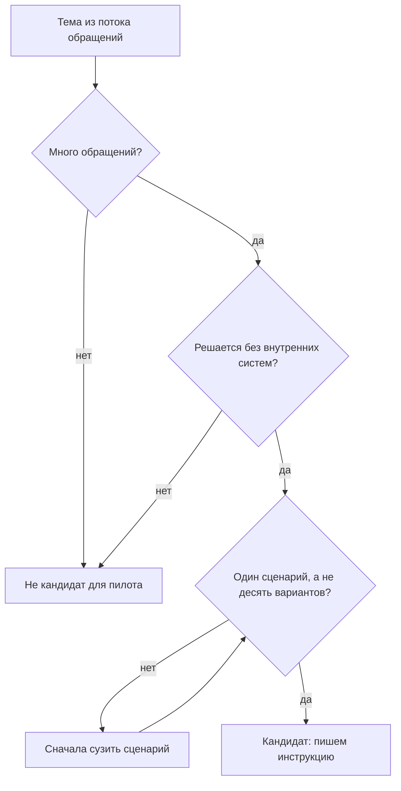
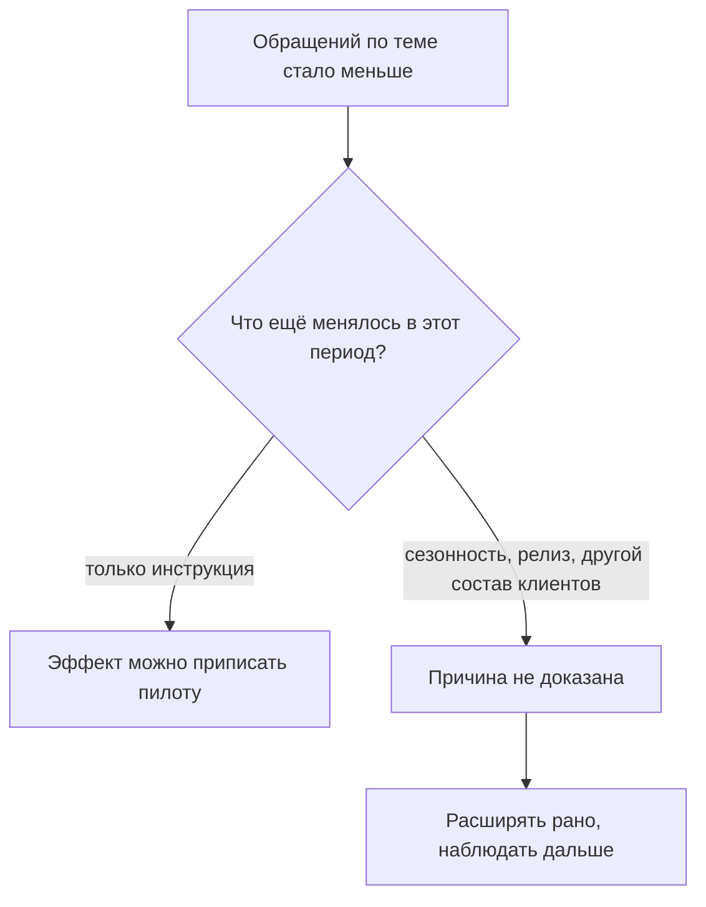

## Введение

Однажды я собрал портал самообслуживания: аккуратные статьи, красивый поиск, ссылка в письмах. Через квартал обращений меньше не стало. Формально портал работал; фактически им пользовались те же три инженера, которые и без него знали, что делать.

С тех пор я смотрю на самообслуживание иначе. Оно не про статьи и не про портал. Оно про то, чтобы клиент смог закрыть свой вопрос без нас — и чтобы мы могли это доказать цифрами, а не ощущением «стало лучше».

В терминах ITIL 4 это Shift Left — перенос решения как можно ближе к источнику проблемы. Для поддержки это значит: сценарий, который не требует нашей экспертизы, уходит из очереди к клиенту, а экспертиза остаётся на том, что действительно требует человека. Пилот на трёх-пяти сценариях с честным измерением полезнее большого портала без метрик.

В [дорожной карте года](/ru/blog/support-lead-year-roadmap/) самообслуживание стоит третьим кварталом — после базы знаний и до разговора с продуктом, и это не случайный порядок.

## Почему «просто напишите инструкции» не работает

Первое, что приходит в голову: взять статьи из базы знаний и выложить для клиентов. Обычно это заканчивается ничем, и причины у этого четыре.

**Текст написан не для клиента.** Внутренняя статья отвечает на вопрос инженера: где смотреть, что проверить, как подтвердить. Клиенту нужнó другое — что нажать и как понять, что получилось. Термины вроде «уровень логирования» или «перевыпуск сертификата» понятны нам и не понятны человеку, который читает инструкцию впервые.

**Нет точки входа.** Даже хорошая инструкция бесполезна, если клиент не знает, что она есть. Клиент ищет там, где ему больно: в почте, в чате, в поисковике. Если инструкции живут на отдельном сайте, до которого надо дойти по трём ссылкам, до неё дойдут единицы.

**Нет измерения.** Снижение потока можно объяснить чем угодно: сезонностью, релизом, изменением состава клиентов. Без заранее определённого окна и метрики любой результат будет толковаться в пользу пилота.

**Инструкция без обслуживания гниёт.** Продукт меняется, шаги устаревают, и клиент, один раз не справившийся по инструкции, больше в неё не поверит.

Все четыре причины — про одно: инструкция для клиента — это отдельный продукт со своими требованиями, а не выгрузка внутренней базы.

## Выбор сценариев по данным потока

Первый шаг пилота — не написать инструкции, а выбрать, для чего их писать. Основа выбора — данные потока, а не желание или удобство.

Смотреть надо на четыре вещи, и только их сочетание даёт хорошего кандидата:

| Критерий | Вопрос к данным | Почему важно |
| --- | --- | --- |
| Объём | Сколько обращений по теме за период | На большом потоке виден эффект |
| Простота | Решается ли без доступа к внутренним системам | Клиент не сможет сделать шаг за нас |
| Повторяемость | Один сценарий или множество вариантов | Инструкция должна покрывать большинство случаев |
| Риск ошибки | Что будет, если клиент сделает не так | Цена неверного шага должна быть нулевой |

Сценарий, который проходит все четыре фильтра, — кандидат. Сценарий, который прошёл три, но требует административных прав или действий на нашей стороне, — не кандидат, каким бы массовым он ни был: его место в другом механизме.

Как выглядит отбор:

<!-- вилка: ваши сценарии-кандидаты — какие темы попали в топ по объёму и почему выбрали именно их. -->

Обычно в топ попадают самые скучные вещи: восстановление доступа, проверка статуса заявки, типовые настройки, забытые пароли. Это нормально: самообслуживание начинается не с интересного, а с частого.

## Формат инструкции для клиента

Инструкция для клиента отличается от статьи базы знаний не глубиной, а адресатом. Собрать её нужно так.

- **Заголовок — словами клиента.** Не «Ошибка авторизации в ЛК», а «Не открывается личный кабинет после смены пароля». Так его найдёт поиск и так его узнает человек.
- **Без диагноза.** Клиенту не нужно знать, почему это происходит; причина — наша забота. Если без объяснения шаг кажется бессмысленным, добавляется одна фраза, а не абзац.
- **Один шаг — одно действие.** Нумерованный список, где каждый пункт можно выполнить, не возвращаясь назад.
- **Проверка результата.** После шагов — как убедиться, что получилось.
- **Что делать, если не помогло.** Прямой маршрут в поддержку и список того, что приложить к обращению. Это самое важное поле: инструкция, после которой человек остаётся один, хуже отсутствия инструкции.
- **Короткий путь до неё.** Ссылка из письма, из формы заявки, из чата — оттуда, где клиент уже находится.

Отдельно — версия. Если в продукте несколько версий или редакций, инструкция должна говорить, для какой. Иначе первое же расхождение обнулит доверие.

## Сигналы полезности

Пилот без измерения превращается в спор о вкусах. Поэтому метрики определяются заранее: что считаем, за какое окно, с чем сравниваем.

Сигналов четыре, и они разной силы:

1. **Обращения по теме.** Их число до и после — самый прямой сигнал, но и самый шумный.
2. **Использование.** Открытия инструкции, переходы по ссылкам, отметки «помогло» или «не помогло» внутри страницы.
3. **Повторные обращения после инструкции.** Если клиент прочитал и всё равно пришёл — инструкция не сработала, и это ценнее любого роста открытий.
4. **Качество общения.** Не выросли ли обращения «я тут всё сломал по вашей инструкции» — плата за неудачные шаги.

Главная осторожность при интерпретации: снижение потока — признак, а не доказательство. За то же окно могли случиться сезонный спад, релиз, изменивший поведение, или приход другой группы клиентов. Поэтому в отчёте о пилоте фиксируются не только цифры, но и то, что ещё менялось в этот период.

Как проверяется вывод об эффекте:

<!-- вилка: измерение до и после — какая метрика, за какое окно, что ещё менялось в этот период. -->

Если эффект есть, но объясняется не инструкцией, это тоже полезный результат: он значит, что настоящая причина потока была в другом месте, и теперь её видно.

## Критерии продолжения пилота

Расширять пилот или свернуть — решение, которое лучше принять заранее, до того как появятся цифры и захочется их защищать.

Я формулирую четыре условия, при которых пилот расширяется:

- **Эффект измерен и устойчив.** Снижение по теме держится не одну неделю, а хотя бы два сопоставимых периода.
- **Клиенты не стали злее.** Обращения «сделал по инструкции, стало хуже» не выросли, а общая оценка качества не упала.
- **Знание не потеряно.** Статья в базе знаний обновлена и отражает то же, что инструкция: иначе мы разошлись с собой в двух источниках.
- **Поддержание посильно.** У кого-то есть часы на обновление инструкций при каждом изменении продукта. Если нет — расширять рано.

Если хотя бы одно условие не выполнено, пилот не расширяется, но и не обязательно закрывается: чаще всего он остаётся на текущих сценариях и доводится до ума. Расширять раньше, чем отлажен первый цикл обновления, — самый частый способ получить мёртвый портал.

<!-- вилка: критерии, по которым вы решали расширять или сворачивать пилот, и что в итоге сделали. -->

И последнее. Shift Left не отменяет поддержку и не сокращает её ценность — он переносит её туда, где она нужна. Клиент, который сам восстановил доступ, приходит к нам с вопросом, на который мы действительно можем ответить лучше него. Именно это и есть цель пилота.
