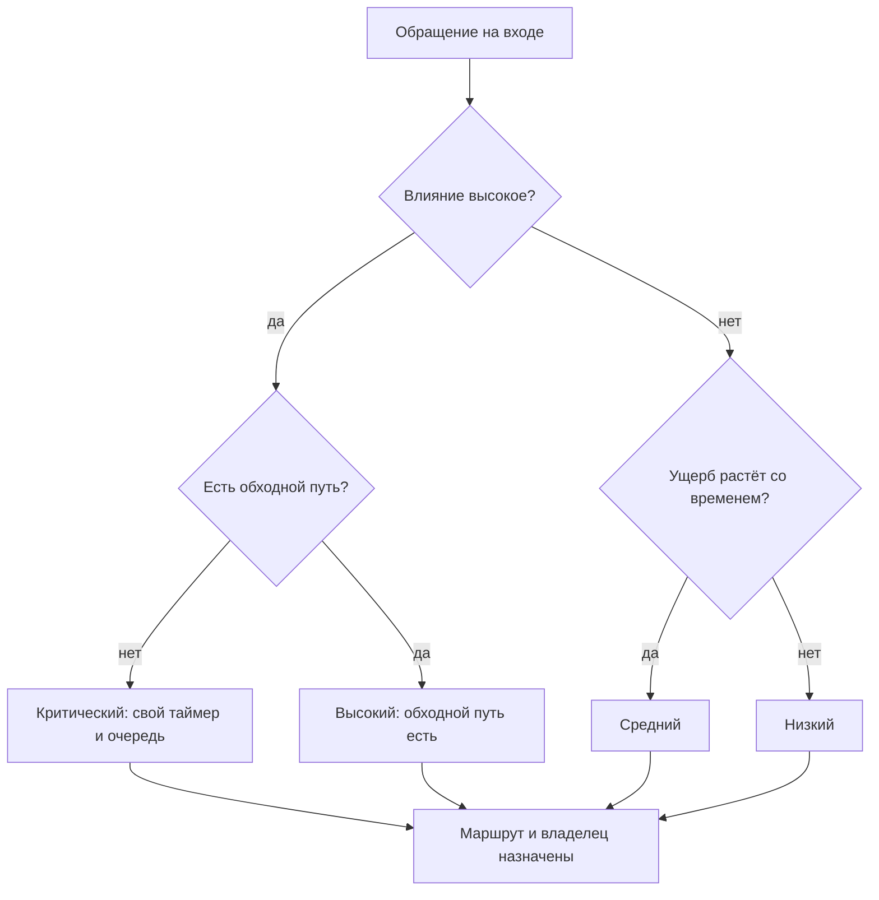
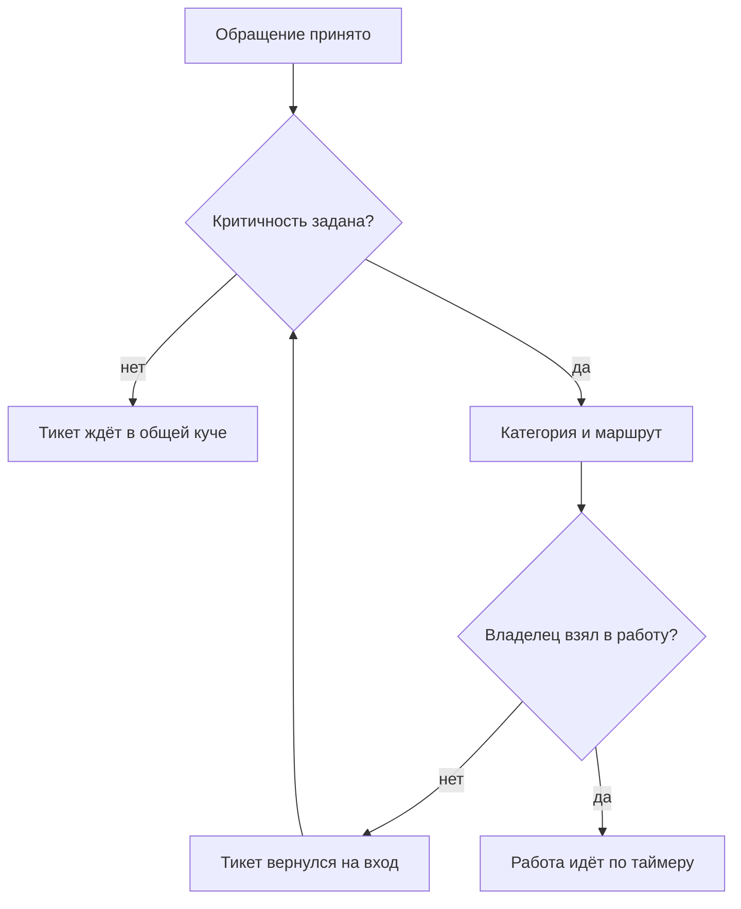

## Введение

Триаж — это три решения, которые принимаются в момент первого касания обращения: насколько это критично, что это за обращение и кому оно идёт. Три решения, на которые уходит несколько минут, и от них зависит всё остальное время жизни заявки.

В первые месяцы на позиции лида я триажем не занимался. Точнее, занимался, но не называл так: открывал тикет, читал, думал «это к Саше», перекладывал — а приоритет оставлял тот, что был при создании. То есть никакой. Через месяц выяснилось, что очередь живёт своей жизнью: там перемешаны инциденты, вопросы по документации и запросы на доработку, тикеты на интеграцию висят рядом с просьбой поменять подпись в письме, а самое критичное всплывает не потому, что оно критичное, а потому, что клиент позвонил.

В предыдущей статье серии — «Карта сервиса и Точка А: диагностика первого месяца» — речь шла о том, чтобы увидеть маршруты и замерить реакцию. Эта статья о том, что превращает несколько маршрутов в управляемый поток: точка входа, где обращения получают критичность, категорию и владельца.

Тезис простой: триаж — единственный вход в сервис, и порядок решений внутри него не произвольный. Сначала критичность, потом классификация. Кто переставляет эти два шага местами, тот получает аккуратную аналитику по вчерашним пожарам.

## Что происходит без триажа

Без триажа поток управляется не правилами, а громкостью. Кто громче написал, тот и в очереди первый; кто умеет звонить напрямую — вообще вне очереди.

Так выглядит типовой набор симптомов:

- **Всё срочное.** Приоритет ставит автор обращения, и для него его вопрос всегда самый важный. В очереди оказываются одни «высокие», и различить их невозможно.
- **Тяжёлые заявки перегружены лишним.** Третья линия получает всё подряд, включая вопросы, на которые есть ответ в документации. Разработка тонет в поддержке, поддержка ждёт разработку, сроки не двигаются ни с одной стороны.
- **Критичное тонет в общем потоке.** Инцидент, который затрагивает всех клиентов, лежит в одной куче с косметическими правками: у них одинаковый приоритет и общий порядок разбора.
- **Нет данных.** Из потока нельзя ответить на вопрос, сколько было инцидентов, сколько запросов на изменение и где реально болит. Категории не заполнены или заполнены «прочее».
- **Возвраты не видны.** Заявка прошла три линии, вернулась и была переоткрыта — никто не считает, что это и есть сигнал. Подробнее об этом — в статье «Ни одного тихого нарушения SLA: еженедельный контроль очереди».
- **Лид снова диспетчер.** Пока маршрутизацией занимается самый доступный человек, сервис держится на нём одном — ровно та роль, от которой мы отказывались в статье [«Границы ответственности»](/ru/blog/support-lead-boundaries/).

<!-- вилка: пример недели без триажа — что именно происходило с очередью и чем это закончилось. -->

Каждый из этих симптомов по отдельности кажется мелочью. Вместе они дают одно: сервис, в котором нельзя ни планировать, ни обещать.

## Сначала критичность, потом классификация

Порядок двух шагов — не педантизм, а следствие того, что каждый из них запускает.

**Критичность запускает таймер и ставит в очередь.** Как только обращение создано, время пошло. Если через час выясняется, что это авария, а не вопрос, таймер уже час как идёт, а тикет час как стоит не в той очереди. Поэтому критичность ставится первой и ставится по тому, что видно на входе.

**Классификация выбирает маршрут и питает аналитику.** Категория отвечает на вопрос, кому идти и что потом считать. Её можно уточнить: инженер, разобравшийся в проблеме, почти всегда уточняет категорию, и это нормально.

Разница в цене ошибки объясняет порядок. Ошибка в критичности стоит сорванного срока и потерянного клиента, потому что она определяет, когда мы обязаны ответить. Ошибка в категории стоит строчки в отчёте, которую можно исправить при закрытии. Первое решение исправляется дорого, второе — почти бесплатно. Значит, первым делается то, что дорого.

Есть и практическая причина. Критичность оценивается по влиянию: сколько людей затронуто и есть ли обходной путь. Это видно из текста обращения и из ответов на два вопроса. Категория требует понимания причины, а причина при первом касании часто неизвестна. Ставить классификацию первой — значит гадать о причине, пока клиент ждёт ответа на следствие.

Три правила, которые я держу в голове при каждом первом касании:

1. **Критичность ставится по влиянию, а не по тону.** Клиент, который пишет спокойно, может сообщать о полном отказе сервиса. Клиент, который пишет капсом, может просить поменять логотип.
2. **Критичность можно повысить без разбора, понизить — только с объяснением.** Асимметрия защищает от оптимизма: повышение всегда безопасно, понижение требует записать, почему решили, что не страшно.
3. **Пустая критичность — не «средняя по умолчанию».** Поле, которое можно не заполнять, не заполняется никогда. Если значение не выбрано, триаж не завершён.

## Матрица критичности и таймеры

Основа для решения — матрица из двух измерений: влияние и срочность. Влияние — сколько людей и функций затронуто, есть ли обходной путь. Срочность — растёт ли ущерб со временем или можно подождать до планового окна. Такой способ назначения приоритета описан в ITIL 4 (набор практик управления ИТ-услугами), и он хорош тем, что не требует обсуждать каждый случай заново.

Так выглядит развилка, которую проходит каждое обращение на входе:

Матрица сводит спор о приоритете к двум вопросам, на которые можно ответить за минуту, не зная причины проблемы. Дальше каждая ячейка получает таймеры: первый ответ, следующее обновление и срок эскалации.

| Уровень | Что означает | Что фиксирует таймер |
| --- | --- | --- |
| Критический | Сервис не работает для многих, обходного пути нет | Первый ответ и момент эскалации в L3 |
| Высокий | Затронуто много людей, но обходной путь существует | Первый ответ и срок решения |
| Средний | Затронут один клиент или одна функция, ущерб умеренный | Первый ответ в рабочие часы |
| Низкий | Вопрос или косметика, работа идёт по плану | Ответ в порядке очереди |

Цифры в таймерах — предмет договорённости, а не творчества лида. Цель вроде «первый ответ за 30 минут» на критическом уровне означает, что кто-то в это время обязан быть на месте, а L3 обязан ответить по своей части за сопоставимое время. Таймер, который держится только на первой линии, — это обещание, которое первая линия не может выполнить в одиночку.

<!-- вилка: своя матрица и таймеры по уровням, согласованные с L3. -->

## Маршрутизация тикета

После критичности и категории у обращения должен появиться владелец. Маршрут — это не только «кому», но и три вещи сразу: кто ведёт, что от него ждут и к какому моменту.

Что входит в маршрут:

- **зона** — линия, продукт или система, к которой относится обращение;
- **компетенция** — человек или группа, у которых есть право и знание решить этот класс задач;
- **ожидание** — что должен увидеть клиент и когда, включая случай «приняли, разбираемся, обновим к такому-то времени»;
- **следующий шаг при срыве** — кому уходит тикет, если владелец не уложился.

Работает приём, который сначала кажется бюрократией: маршрут фиксируется одной строкой в тикете. Не длинным описанием, а фразой «зона — интеграция с порталом, что проверили — логи и доступы, ждём — ответ разработки, срок — по таймеру высокого уровня». Такая строка стоит минуту на входе и снимает половину повторных вопросов внутри команды.

Отдельно про линии. Триаж не решает, кто прав, он решает, кто первый. Если инженер первой линии может закрыть тикет сам — он закрывает; если нет — передаёт с пакетом, а не с текстом «посмотри». Маршрут без пакета — это не передача работы, а её перекладывание: тикет вернётся с вопросами, и время уйдёт на них, а не на решение.

## Где триаж ломается

Триаж — самое хрупкое место сервиса, потому что он делается быстро и на входе, где меньше всего информации. Типичные поломки видны прямо в трекере.

- **Пустая критичность.** Поле есть, значение не выбрано. Лечится не уговорами, а запретом: тикет без критичности не считается принятым в работу.
- **«Срочное» по умолчанию.** Если приоритет выбирается первым пунктом списка или одним кликом, через месяц всё будет высоким. Помогает объяснение в интерфейсе: что именно означает каждый уровень, на примерах.
- **Возвраты между линиями.** Тикет сходил во вторую линию, вернулся, ушёл в третью. Это не нормальный ход работы, а признак плохого маршрута или пустого пакета.
- **Триажит самый свободный.** Обычно это новичок, который не знает признаков аварии. Триаж — не самая простая задача в поддержке, а одна из самых ответственных: ошибка здесь стоит дороже всего.
- **Триаж вне таймера.** Время, потраченное на разбор входящих, не входит ни в один отчёт. Тогда сервис выглядит быстрым на бумаге и медленным для клиента.
- **Триаж на одном человеке.** Пока решения принимает один инженер или тем более лид, поток останавливается вместе с его отпуском.

Триаж не делает сервис быстрым сам по себе. Он делает его предсказуемым: у каждого обращения есть приоритет, владелец и срок, о котором знают все участники. Предсказуемость — то, что позволяет потом обещать клиенту сроки и не краснеть. Как только это работает, возникает следующий вопрос: кто следит за тем, чтобы сроки не истекали тихо. Об этом — в статье «Ни одного тихого нарушения SLA: еженедельный контроль очереди».
