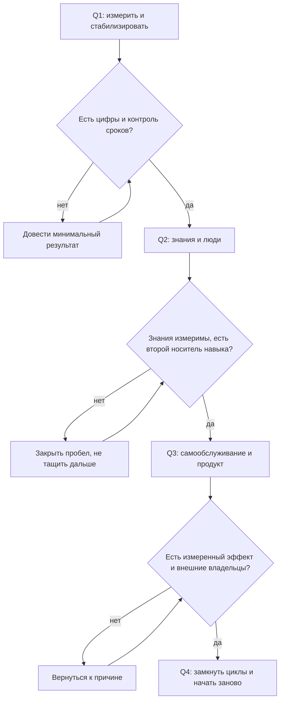

## Введение

В первый год на позиции лида поддержки я составил план из девятнадцати инициатив. Через три месяца не осталось ни одной: часть сгорела в операционке, часть потеряла смысл после первых данных, часть я просто забыл. Сервис при этом не стал хуже — он просто не изменился.

В предыдущей статье серии — [«Baseline раньше целей»](/ru/blog/support-lead-baseline-first/) — речь шла о точке А и калибровке целей с руководством. Эта статья о следующем шаге: как из согласованных целей собирается календарь, в котором хватит места и на операционную работу, и на изменения.

Главная мысль, к которой я пришёл через несколько таких лет: дорожная карта — это не список желаний, а последовательность. Ценность в ней не в том, что в неё входит, а в том, в каком порядке это происходит и что нельзя начать, пока не закончено предыдущее.

## Почему планы из двадцати инициатив не выживают

Инициативы редко проваливаются по отдельности. Они проваливаются вместе, и причины у этого общие.

- **Всё меняется одновременно.** Триаж, база знаний, метрики, найм и Shift Left запускаются в одном месяце — и ни одно из изменений не получает внимания, нужного для запуска.
- **У изменений нет критерия «готово».** «Внедрить KCS» звучит как задача, но не отвечает на вопрос, когда работу можно считать сделанной. Незакрытая задача живёт годами и переходит из квартала в квартал, занимая место в повестке.
- **Изменения конкурируют с операционкой.** Очередь не спрашивает, есть ли у вас квартал изменений. Первая же неделя инцидентов съедает время, отведённое на процессы, и дальше план живёт только в презентации.
- **Команда перестаёт верить в инициативы.** Пятая попытка «начать вести базу знаний» воспринимается как шум, который надо пережить. После этого даже хорошая инициатива требует отдельных усилий на восстановление доверия.
- **Нет видимого движения.** Год заканчивается, а в сервисе ничего не поменялось: заявки те же, сроки те же, и объяснить, чем занимался лид, можно только списком проведённых встреч.

Девятнадцать инициатив проигрывают не потому, что они плохие. Они проигрывают без порядка: у каждой по отдельности есть смысл, у набора — нет.

## Четыре квартала года

Работающий каркас года для лида поддержки — четыре квартала, у каждого своя задача и свой тип результата. Не потому, что такой календарь красивый, а потому, что каждый следующий блок опирается на артефакты предыдущего.

### Первый квартал: измерить и стабилизировать

Задача квартала — перестать управлять вслепую и снять самые тяжёлые операционные пожары.

- **Месяц 1: карта сервиса и точка А.** Выгрузка из трекера, описание потока, узкое место.
- **Месяц 2: цели и калибровка.** Проверяемые результаты года, согласованные с руководством письменно.
- **Месяц 3: первый контур стабильности.** Триаж при первом касании, контроль сроков, маршрут эскалаций. Не «внедрено полностью», а «работает и не висит на лиде».

Критерий готовности квартала: у сервиса есть цифры, у цифр есть определения, у нарушений сроков есть регулярный контроль, и вы можете уйти в отпуск на две недели без обвала очереди.

### Второй квартал: знания и люди

Задача — превратить знания в актив и снять одноточечные зависимости в команде.

- База знаний по KCS (Knowledge-Centered Service — подход, в котором статья пишется в момент решения, а не после) и шаблон статьи с владельцем.
- Записи по повторяющимся проблемам: от потока тикетов к списку с владельцами и статусами.
- Регулярные 1:1, оценка по наблюдаемым фактам, матрица компетенций.

Критерий готовности: доля решений со ссылкой на статью измерима и растёт, повторяющиеся проблемы перенесены из потока в реестр, у каждого критичного навыка есть второй носитель.

### Третий квартал: самообслуживание и продукт

Задача — вынести часть потока из поддержки и начать говорить с продуктом на языке данных.

- Пилот Shift Left (перенос решения к пользователю через самообслуживание) с честным измерением: сколько обращений не дошло до поддержки.
- Матрица взаимодействий: кто принимает решения по каким вопросам — с продуктом, разработкой, эксплуатацией.
- Карточки проблем для продукта с данными, статусом и владельцем на той стороне.

Критерий готовности: работает хотя бы один канал самообслуживания с измеренным эффектом; у каждой проблемы, которую нельзя решить внутри поддержки, есть карточка и внешний владелец; в общем статусе появляются данные, а не «много обращений».

### Четвёртый квартал: замкнуть циклы

Задача — сделать так, чтобы работа следующего года начиналась не с чистого листа.

- Паспорта метрик: что измеряем, зачем, какое действие следует из значения.
- Статусы руководству в регулярном формате и запросы решений вместо просьб о сочувствии.
- Blameless-разборы инцидентов и аудит живучести: что сломается, когда вас не будет.
- Годовой отчёт и новый baseline — уже не с нуля, а с историей.

Критерий готовности: у каждой метрики есть владелец и действие, у каждого инцидента — разбор без имён и хотя бы одно изменение в системе, следующий год начинается с плана, а не с диагностики.

Как связаны кварталы:

<!-- вилка: свои вехи по месяцам — что именно сделано в каждом квартале и какой результат это дало. -->

## Правило последовательности

Правило, которое я формулирую одной строкой: следующий квартал не начинается, пока у предыдущего нет результата. Оно неприятное — именно оно заставляет отказываться от интересного в пользу нужного.

За ним стоят четыре конкретные зависимости:

1. **Без точки А нет метрик KCS.** Доля решений со ссылкой на статью — бессмысленное число, если неизвестно, сколько решений вообще и какие из них должны были идти через базу.
2. **Без базы знаний нет Shift Left.** Самообслуживание без проверенных статей перекладывает на пользователя поиск по мусору. Первый же такой опыт закрывает канал надолго.
3. **Без Shift Left нет разговора с продуктом.** Пока весь поток уходит в поддержку, у вас нет аргумента для продукта: вы говорите о боли, а не о масштабе.
4. **Без метрик нет годового отчёта.** Отчёт из ощущений и красивых схем не переживает первого уточняющего вопроса.

Что делать, если квартал провален — общая рекомендация одна: не тащить следующий блок. Соблазн понятен — год идёт, надо догонять. Но каждая часть дорожной карты опирается на предыдущую, и незакрытый пробел превращает следующую инициативу в декорацию. Лучше потратить начало следующего квартала на минимальный результат предыдущего — маленький, но настоящий: одна статья базы знаний с владельцем, один контроль сроков, одна измеренная веха.

## Ритм и буферы

Дорожная карта умирает не от плохих идей, а от нехватки времени на их выполнение. Поэтому в календаре должны быть зарезервированы три вещи.

- **Время лида на изменения.** Правило 40 %: не меньше двух дней в неделю на то, что не горит сейчас. Если неделя целиком уходит на очередь, квартальные вехи не случатся никогда.
- **Буфер на инциденты.** Планировать квартал без запаса — значит закладывать провал в план. Я держу в каждом месяце неделю, которую заранее считаю потерянной.
- **Точка ревизии.** Раз в квартал — час на пересборку плана: что сделано, что переносится, что отменяется. Отменять важнее, чем переносить: список из девятнадцати пунктов начинается именно с неспособности вычеркнуть.

<!-- вилка: ваш ритм — сколько времени в неделю уходит на изменения, как выглядит квартальная ревизия. -->

## Оглавление серии

Этот текст — четвёртая статья серии «Стратегия управления поддержкой», и он же служит оглавлением: статьи выходят блоками, порядок отражает логику зависимостей.

**Стратегическая рамка года**

- [Пять результатов работы лида поддержки](/ru/blog/support-lead-five-results/)
- [Границы ответственности: что лид делает сам, делегирует и от чего отказывается](/ru/blog/support-lead-boundaries/)
- [Baseline раньше целей: почему годовые планы проваливаются на старте](/ru/blog/support-lead-baseline-first/)
- Год лида по кварталам: дорожная карта на 12 месяцев — эта статья

**Стабилизация сервиса**

- Карта сервиса и Точка А: диагностика первого месяца
- Триаж при первом касании: категория, критичность, маршрут
- Ни одного тихого нарушения SLA: еженедельный контроль очереди
- Эскалация в L3: пакет, OLA и владелец клиента

**Знания как система**

- KCS в рабочем потоке: статья пишется в момент решения
- Шаблон статьи базы знаний и владелец КБ
- Повторяющиеся проблемы: от потока тикетов к записям с владельцем
- Самообслуживание как Shift Left: пилот с честным измерением

**Команда: люди и развитие**

- Ритм руководителя: правило 40 %
- 1:1, которые не превращаются в отчёт и аттестацию
- Оценка по наблюдаемым фактам: QA-выборка и шесть критериев
- Матрица компетенций: закрываем одноточечные риски
- Мощность вместо героизма: расчёт потребности в инженерах

**Внешний контур**

- Матрица взаимодействий: кто решает и по каким вопросам
- Статус руководству: письмо на страницу и часовой обзор
- Просить решения, а не сочувствия: эскалация и запрос ресурсов
- Blameless-разбор инцидента: хронология без имён
- Карточка проблемы для продукта, которую не закрыть без статуса

**Метрики и замыкание года**

- Метрика без действия — это картинка: паспорт метрики
- Аудит живучести: что сломается, когда вас не будет
- Девять ошибок лида поддержки — и годовой отчёт

Ссылки на статьи добавляются по мере выхода; названия остальные сохраняют свой порядок и место в плане.

## Что остаётся от такого года

Дорожная карта на двенадцать месяцев не гарантирует, что всё получится. Она гарантирует другое: к концу года вы сможете показать, что изменилось и почему, а не вспоминать, чем занимались. Четыре квартала — это не строгая методология, а способ не менять всё сразу и не бросать начатое.

Если из всего текста нужна одна фраза — возьмите эту: сначала цифры, потом знания, потом самообслуживание, потом внешний контур. Всё остальное — детали исполнения, которые можно менять под свой сервис.
